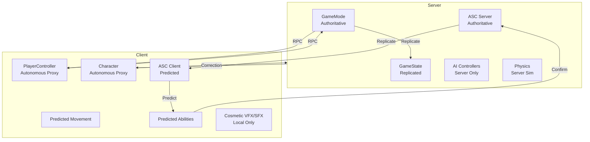

# ADR-008: Client-Server with Prediction for Multiplayer

## Status
🟡 Proposed

## Context
The framework targets single-player initially but must support multiplayer (co-op, PvP) in v0.4+. Network architecture must be decided early to avoid rewrites.

## Decision
Use Unreal's standard client-server model with:
- **Server-authoritative** gameplay (movement, abilities, damage)
- **Client-side prediction** for movement and abilities
- **Server reconciliation** for corrections
- **Lag compensation** for shooting/melee

## Consequences

### Positive
- **Standard Pattern**: Well-documented, community knowledge, Epic support
- **Prediction**: Responsive local feel, immediate feedback
- **Reconciliation**: Corrects desync, prevents cheating
- **Scalability**: Supports 2-100+ players with proper optimization
- **Replay**: Built-in demo recording

### Negative
- **Complexity**: Prediction, reconciliation, lag compensation are hard
- **Bandwidth**: Movement + ability replication = significant traffic
- **Debugging**: Desyncs, prediction errors difficult to reproduce
- **Determinism**: Requires deterministic simulation (fixed tick, same math)

### Neutral
- **Peer-to-Peer**: Not suitable for action games (cheating, NAT traversal)
- **Listen Server**: Supported (host + client), but dedicated preferred

## Architecture

## Key Technical Decisions

| Aspect | Decision |
|--------|----------|
| **Movement** | `UCharacterMovementComponent` built-in prediction |
| **Abilities** | GAS prediction (client activates, server validates) |
| **Attributes** | Replicate to Owner + Relevant (not all) |
| **Gameplay Effects** | Server applies, replicates to Owner + Relevant |
| **Gameplay Cues** | Multicast (Unreliable) for cosmetic |
| **AI** | Server-only StateTree, replicate transforms |
| **Projectiles** | Server-spawned, replicate movement |
| **Melee** | Server-authoritative hit detection, client predicts |

## Alternatives Considered
- **Rollback Netcode (GGPO)**: Better for fighting games, not general action
- **Deterministic Lockstep**: RTS-style, not suitable for action
- **Peer-to-Peer**: Cheating, NAT issues, not for competitive

## References
- [UE Networking Overview](https://docs.unrealengine.com/5.8/en-US/unreal-networking-architecture/)
- [GAS Networking](https://docs.unrealengine.com/5.8/en-US/gameplay-ability-system-networking/)
- `Source/DA/TDD/04-Networking.md`: Detailed design
- `Source/DACharacters/Private/DACharacterMovementComponent.cpp`: Prediction hooks