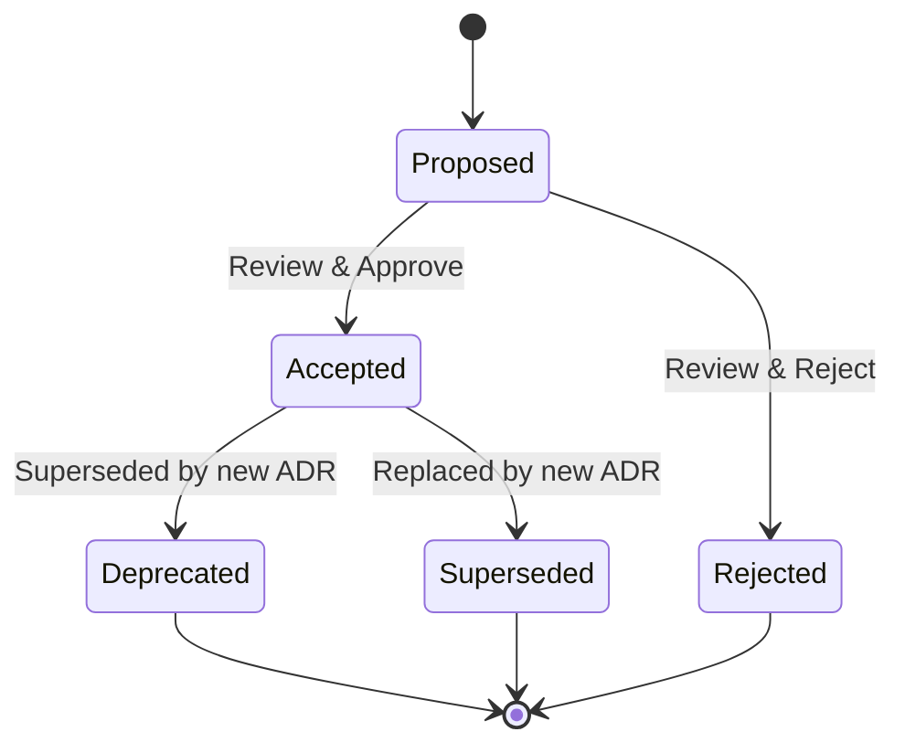

# Architecture Decision Records (ADR) Index

<div align="center">


[← Wiki Home](../Wiki/Home.md) | [TDD Overview](../TDD/00-Overview.md)

</div>

---

## 📋 ADR List

| ID | Title | Status | Date | Supersedes |
|----|-------|--------|------|------------|
| [001](001-CPP20.md) | Use C++20 Standard | ✅ Accepted | 2026-10-10 | — |
| [002](002-EnhancedInput.md) | Enhanced Input over Legacy Input | ✅ Accepted | 2026-10-10 | — |
| [003](003-StateTree.md) | StateTree over Behavior Trees | ✅ Accepted | 2026-10-10 | — |
| [004](004-GAS.md) | Gameplay Ability System for Abilities | ✅ Accepted | 2026-10-10 | — |
| [005](005-DataDrivenVariants.md) | Data-Driven Variant Configuration | ✅ Accepted | 2026-10-10 | — |
| [006](006-ModuleArchitecture.md) | Three-Module Architecture (DA, DACharacters, DAEditor) | ✅ Accepted | 2026-10-10 | — |
| [007](007-AsyncLoading.md) | Async Asset Loading for Variants | 🟡 Proposed | 2026-10-10 | — |
| [008](008-NetworkModel.md) | Client-Server with Prediction for Multiplayer | 🟡 Proposed | 2026-10-10 | — |
| [009](009-Nanite.md) | Nanite for Static Geometry | 🟡 Proposed | 2026-10-10 | — |
| [010](010-TestingStrategy.md) | Automation Testing + Gauntlet for Gameplay | 🟡 Proposed | 2026-10-10 | — |

---

## 📝 ADR Template

```markdown
# ADR-XXX: Title

## Status
[Proposed | Accepted | Rejected | Deprecated | Superseded]

## Context
What is the issue that we're seeing that is motivating this decision?

## Decision
What is the change that we're proposing and/or doing?

## Consequences
What becomes easier or more difficult to do because of this change?

### Positive
- 

### Negative
- 

### Neutral
- 

## Alternatives Considered
- Alternative 1: Pros/Cons
- Alternative 2: Pros/Cons

## References
- Links to related docs, issues, PRs
```

---

## 🔄 ADR Lifecycle



---

## 📋 How to Create an ADR

1. **Copy template** from above
2. **Create file** in `Docs/ADR/XXX-Title.md` (next number)
3. **Fill in** Context, Decision, Consequences
4. **Submit PR** with `#adr` label
5. **Review** by maintainers (48h SLA)
6. **Merge** → Update this index

---

## 🎯 When to Write an ADR

| Situation | ADR Required? |
|-----------|---------------|
| New major dependency | ✅ Yes |
| Architectural pattern change | ✅ Yes |
| Cross-module interface change | ✅ Yes |
| Performance-critical decision | ✅ Yes |
| Security-related choice | ✅ Yes |
| Minor implementation detail | ❌ No (code comment) |
| Temporary workaround | ❌ No (TODO comment) |

---

## 📚 Related Documents

| Document | Link |
|----------|------|
| **TDD Overview** | [../TDD/00-Overview.md](../TDD/00-Overview.md) |
| **Architecture** | [../TDD/01-Architecture.md](../TDD/01-Architecture.md) |
| **Module Design** | [../TDD/02-Module-Design.md](../TDD/02-Module-Design.md) |
| **Contributing Guide** | [../../CONTRIBUTING.md](../../CONTRIBUTING.md) |

---

> **Note**: ADRs are immutable once accepted. To change a decision, create a new ADR that supersedes the old one.