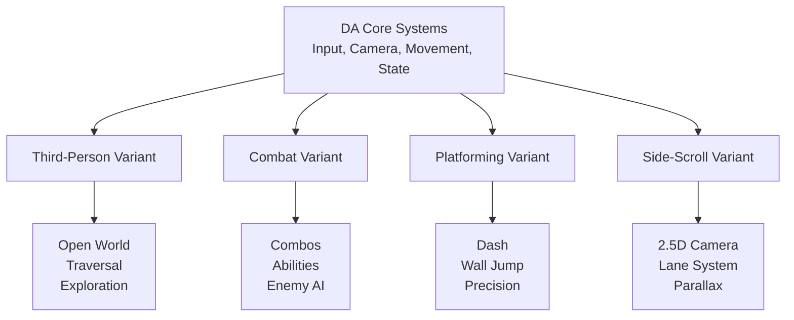

# 🎮 Game Design Document — Overview

**DA Framework** — A modular, multi-variant gameplay foundation for Unreal Engine 5.8+

[← Back to Wiki](../Wiki/Home.md) | [Core Gameplay Loop →](01-Core-Gameplay-Loop.md)

---

## 🎯 Vision Statement

> **Create a reusable, extensible gameplay framework that enables rapid prototyping and production of diverse action game variants (Third-Person, Combat, Platforming, Side-Scrolling) from a single, maintainable codebase.**

### Core Pillars

| Pillar | Description | Success Metric |
|--------|-------------|----------------|
| **Modularity** | Swap gameplay variants without rewriting core | New variant in < 1 week |
| **Extensibility** | Add systems without modifying core | Plugin-style architecture |
| **Performance** | 60 FPS on mid-range hardware | < 16ms frame time |
| **Designer-Friendly** | Blueprints for gameplay, C++ for systems | 80% gameplay in BP |
| **Multiplayer-Ready** | Authority, prediction, reconciliation built-in | Replication from day 1 |

---

## 🎮 Game Concept

### Elevator Pitch

> **DA Framework** is not a single game—it's a **gameplay operating system**. Like Unreal's Lyra sample but more modular, more opinionated on architecture, and built from the ground up for **Enhanced Input + StateTree + GAS** integration.

### Target Experience

| Variant | Core Fantasy | Reference Games |
|---------|--------------|-----------------|
| **Third-Person** | Fluid exploration & traversal | *Ghost of Tsushima*, *Assassin's Creed* |
| **Combat** | Tactical action with depth | *Devil May Cry*, *God of War* |
| **Platforming** | Precision movement mastery | *Celeste*, *Hollow Knight* |
| **Side-Scrolling** | 2.5D action platformer | *Dead Cells*, *Mark of the Ninja* |

---

## 🏗 High-Level Architecture

### Variant Relationship

### Shared Systems (All Variants)

| System | Description | Customization Point |
|--------|-------------|---------------------|
| **Enhanced Input** | Unified input handling | Input Mapping Context per variant |
| **Dual Camera** | 1st/3rd person toggle | Camera parameters per variant |
| **Character Base** | Movement, jumping, collision | Movement config per variant |
| **StateTree** | Behavior/ability logic | StateTree assets per variant |
| **Gameplay Tags** | Query system | Tag hierarchy per variant |

---

## 🎭 Player Experience Goals

### Moment-to-Moment (Seconds)
- **Responsive controls** — Input latency < 2 frames
- **Clear feedback** — Visual, audio, haptic for every action
- **Flow state** — Movement feels natural, not fought

### Minute-to-Minute (Minutes)
- **Meaningful choices** — Combat: ability selection; Platforming: route choice
- **Progress visible** — XP, unlocks, mastery visible
- **Variety** — Enemy types, platforming challenges, combat encounters

### Session-to-Session (Hours)
- **Progression systems** — Unlocks, cosmetics, mastery
- **Replayability** — Variant switching, difficulty, seeds
- **Social** — Co-op, leaderboards, sharing

---

## 🎨 Art & Audio Direction

### Visual Style
| Aspect | Direction |
|--------|-----------|
| **Art Style** | Stylized realism — clean silhouettes, readable shapes |
| **Color Palette** | Variant-specific: TP=Natural, CBT=High Contrast, PLT=Vibrant, SS=Noir |
| **VFX Philosophy** | Gameplay clarity > spectacle; readable hitboxes, clear tells |
| **UI/UX** | Diegetic where possible; minimal HUD; contextual prompts |

### Audio Style
| Aspect | Direction |
|--------|-----------|
| **Music** | Adaptive layers per variant; combat = intense, platforming = rhythmic |
| **SFX** | Weighty, impactful; distinct per action type |
| **Voice** | Minimal; environmental storytelling preferred |

---

## 📋 Scope & Roadmap

### MVP (v0.1) — **Current**
- [x] Core module structure (DA, DACharacters, DAEditor)
- [x] DACharacterBase + DAPlayerCharacter
- [x] Enhanced Input integration
- [x] Dual camera (1st/3rd person)
- [x] Four variant scaffolds
- [x] Basic movement (walk, run, jump, look)
- [x] CI/CD pipeline

### v0.2 — Combat Foundation
- [ ] Gameplay Ability System (GAS) integration
- [ ] Basic combat StateTree
- [ ] Targeting & lock-on
- [ ] Hit reactions & damage numbers
- [ ] Combo system foundation

### v0.3 — Advanced Movement
- [ ] Motion matching animation
- [ ] Procedural IK (feet, ledges)
- [ ] Parkour (vault, climb, slide)
- [ ] Dash/dodge with i-frames

### v0.4 — Multiplayer
- [ ] Network replication for movement
- [ ] Client-side prediction
- [ ] Server reconciliation
- [ ] Lag compensation

### v1.0 — Production Ready
- [ ] All variants feature-complete
- [ ] Editor tools (variant config, input visualizer)
- [ ] Automated playtest framework
- [ ] Performance budgets met
- [ ] Documentation complete

---

## 🔗 Related Documents

| Document | Link |
|----------|------|
| **Core Gameplay Loop** | [01-Core-Gameplay-Loop.md](01-Core-Gameplay-Loop.md) |
| **Variant Designs** | [02-Variant-Designs.md](02-Variant-Designs.md) |
| **Character Design** | [03-Character-Design.md](03-Character-Design.md) |
| **Combat Systems** | [04-Combat-Systems.md](04-Combat-Systems.md) |
| **Level Design** | [05-Level-Design.md](05-Level-Design.md) |
| **Technical Design (TDD)** | [../TDD/00-Overview.md](../TDD/00-Overview.md) |
| **Architecture Decision Records** | [../ADR/Index.md](../ADR/Index.md) |

---

## 📝 Change Log

| Version | Date | Author | Changes |
|---------|------|--------|---------|
| 0.1.0 | 2026-10-10 | Raioix | Initial GDD creation |
| | | | |

---

> **Note**: This GDD is a living document. Update via PR with `#gdd` label. All gameplay decisions should reference or update this document.