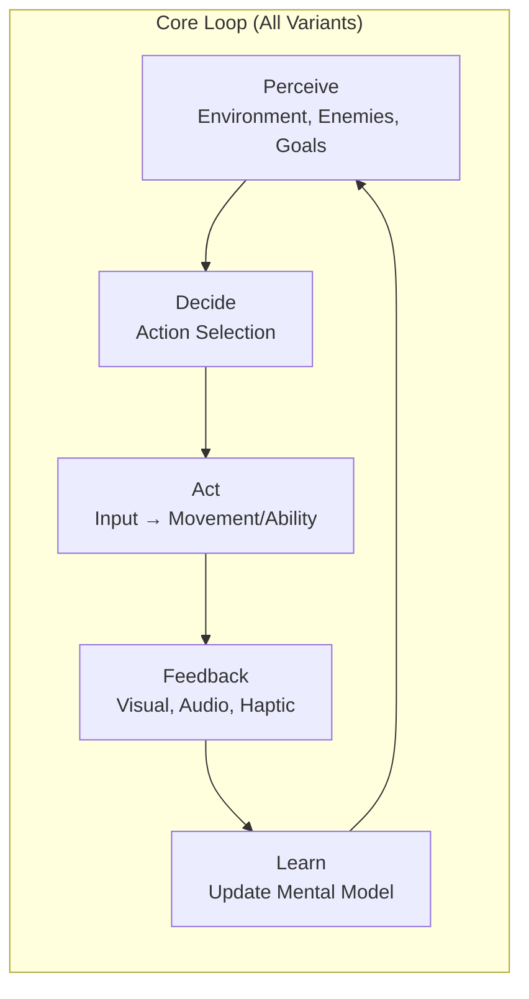
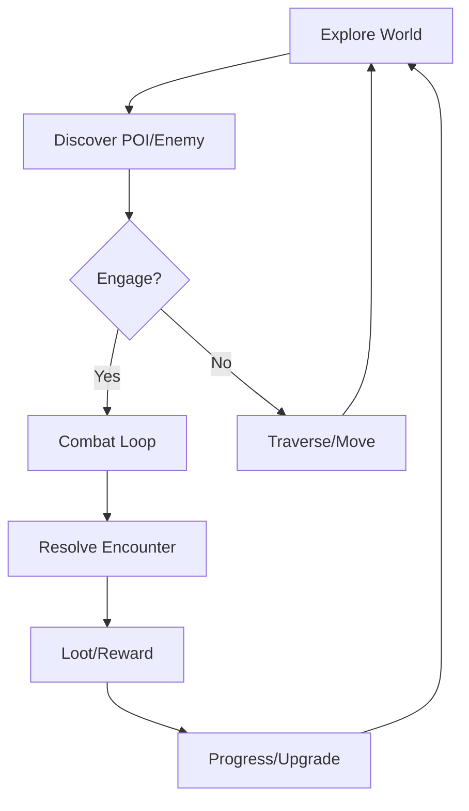
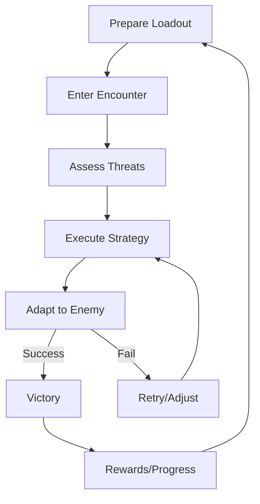
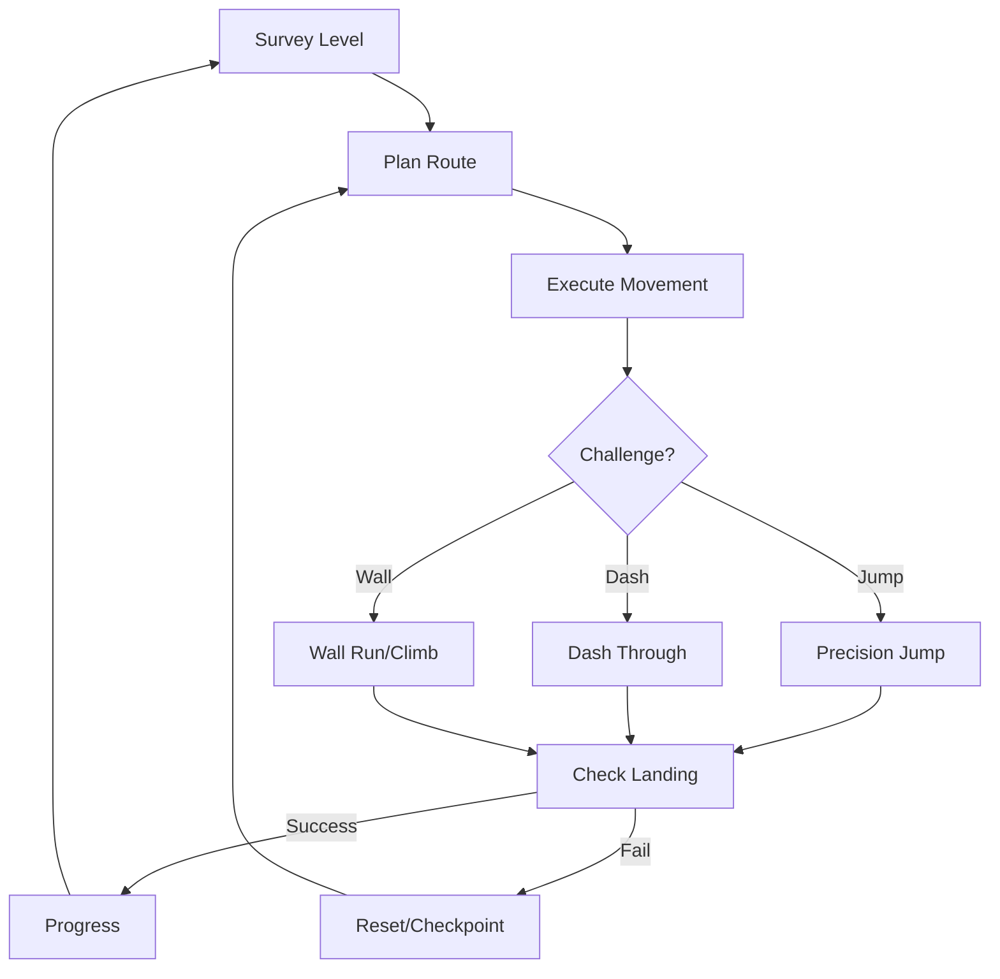
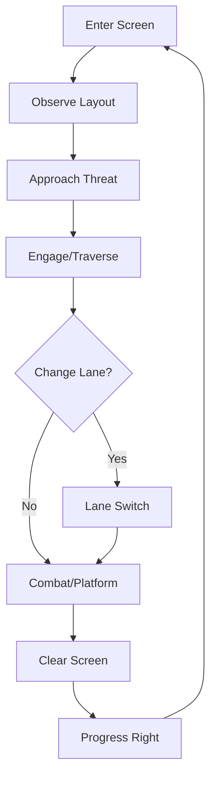
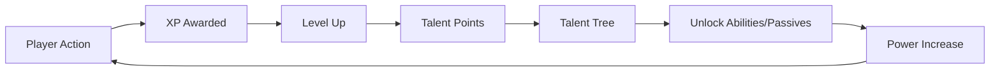

# 🎮 Game Design Document — Core Gameplay Loop

[← GDD Overview](00-Overview.md) | [Variant Designs →](02-Variant-Designs.md)

---

## 🔄 Universal Core Loop

### Loop Timing

| Phase | Duration | Key Systems |
|-------|----------|-------------|
| **Perceive** | Continuous | Camera, UI, Audio, Gameplay Tags |
| **Decide** | 100-500ms | Input Buffer, Ability Queue, AI |
| **Act** | 16-100ms | Movement, Animation, Physics |
| **Feedback** | 50-2000ms | VFX, SFX, Camera Shake, Numbers |
| **Learn** | Continuous | Progression, Stats, Mastery |

---

## 🎮 Variant-Specific Loops

### Third-Person Variant

| Phase | Player Actions | Systems Involved |
|-------|----------------|------------------|
| **Explore** | Walk, run, climb, scan | Movement, Camera, Navigation |
| **Discover** | Investigate, mark, plan | Vision, Tags, Quest System |
| **Engage** | Approach, initiate | AI Detection, StateTree |
| **Combat** | Attack, dodge, ability | GAS, Animation, Physics |
| **Resolve** | Defeat, capture, flee | Health, Death, Rewards |
| **Loot** | Collect, evaluate | Inventory, Progression |
| **Progress** | Upgrade, customize | Talent Tree, Cosmetics |

### Combat Variant

| Phase | Player Actions | Systems Involved |
|-------|----------------|------------------|
| **Prepare** | Select abilities, gear, consumables | Loadout, GAS, Inventory |
| **Encounter** | Position, initiate | AI Spawning, StateTree |
| **Assess** | Identify weaknesses, prioritize | Targeting, Vision, Tags |
| **Execute** | Combo, ability, timing | Input Buffer, Animation Cancel |
| **Adapt** | React, counter, reposition | AI Behavior, Physics |
| **Victory** | Execute finisher, collect | Death, Rewards, Progression |

### Platforming Variant

| Phase | Player Actions | Systems Involved |
|-------|----------------|------------------|
| **Survey** | Camera look, plan path | Camera, Level Geometry |
| **Plan** | Mental model, timing | Player Skill, Visual Cues |
| **Execute** | Jump, dash, wall-run | Movement, Animation, Physics |
| **Challenge** | Precision input | Input Buffer, Coyote Time |
| **Check** | Landing, momentum | Collision, State Machine |
| **Progress** | Checkpoint, collectible | Save System, Progression |
| **Reset** | Respawn, retry | Checkpoint, Load Time |

### Side-Scrolling Variant

| Phase | Player Actions | Systems Involved |
|-------|----------------|------------------|
| **Enter** | Spawn, camera lock | Camera Manager, Level Streaming |
| **Observe** | Scan, identify lanes | Vision, Parallax Layers |
| **Approach** | Move, position | 2D Movement, Lane System |
| **Engage** | Attack, dodge, jump | Combat, Platforming |
| **Switch** | Lane change input | Lane Manager, Camera |
| **Clear** | Defeat all, reach edge | Encounter Manager |
| **Progress** | Auto-scroll or player | Level Progression |

---

## 🎯 Core Mechanics Reference

### Movement Mechanics (Shared)

| Mechanic | Description | Parameters | Variant Tuning |
|----------|-------------|------------|----------------|
| **Walk** | Analog movement | MaxSpeed, Acceleration | TP: 300, CBT: 250, PLT: 200, SS: 150 |
| **Run/Sprint** | Hold sprint + direction | SprintMultiplier, StaminaCost | TP: 2.0x, CBT: 1.8x, PLT: 2.2x, SS: N/A |
| **Jump** | Press jump | JumpZVelocity, AirControl | TP: 700, CBT: 650, PLT: 800, SS: 750 |
| **Air Control** | Mid-air direction change | AirControl, MaxAirAccel | TP: 0.35, CBT: 0.3, PLT: 0.5, SS: 0.4 |
| **Crouch** | Hold crouch | CrouchHeight, SpeedMult | All: 0.5x height, 0.5x speed |
| **Dodge/Dash** | Double-tap + direction | DashDistance, IFrameDuration | CBT: 500/0.3s, PLT: 400/0.2s, SS: 300/0.15s |

### Combat Mechanics (Combat Variant)

| Mechanic | Description | Parameters |
|----------|-------------|------------|
| **Light Attack** | Tap attack | Damage: 15, Speed: 0.4s, Range: 200 |
| **Heavy Attack** | Hold attack | Damage: 35, Speed: 0.8s, Range: 250, Armor Pierce |
| **Combo** | Chain attacks | MaxChain: 4, Window: 0.5s, Damage Bonus: +10%/hit |
| **Ability** | Press ability key | Cooldown, Resource Cost, Tag Requirements |
| **Parry** | Press block at impact | Window: 0.2s, Stun Duration: 1.0s, Riposte |
| **Dodge** | Double-tap move | I-Frames: 0.3s, Distance: 500, Cooldown: 1.0s |

### Platforming Mechanics (Platforming Variant)

| Mechanic | Description | Parameters |
|----------|-------------|------------|
| **Wall Jump** | Jump against wall | PushForce: 600, WallSlideSpeed: 100, Coyote: 0.1s |
| **Wall Run** | Run along wall | MaxDuration: 2.0s, Speed: 800, JumpOffForce: 900 |
| **Ledge Grab** | Fall near ledge | GrabRange: 50, ClimbSpeed: 300, StaminaCost: 10/s |
| **Dash** | Burst movement | Distance: 400, I-Frames: 0.2s, Cooldown: 0.8s |
| **Ground Pound** | Down + jump in air | ImpactRadius: 300, StunDuration: 1.5s, Cooldown: 3.0s |

---

## 📊 Progression Systems

### Experience & Leveling

| Source | XP Amount | Notes |
|--------|-----------|-------|
| Enemy Kill | 50-500 | Scales with level difference |
| Objective Complete | 200-2000 | Main > Side > Dynamic |
| Discovery | 100-500 | POI, lore, secrets |
| Mastery | 50-200 | First clear, no damage, speedrun |

### Talent Trees (Per Variant)

| Variant | Tree Structure | Key Nodes |
|---------|----------------|-----------|
| **Third-Person** | Exploration → Combat → Utility | Sprint Mastery, Glide, Sense |
| **Combat** | Offense → Defense → Utility | Combo Extend, Perfect Parry, Resource Efficiency |
| **Platforming** | Movement → Tricks → Utility | Double Dash, Wall Kick, Momentum Preserve |
| **Side-Scroll** | Melee → Ranged → Mobility | Air Combo, Ricochet, Phase Dash |

---

## 🎒 Economy & Resources

| Resource | Source | Sink | Variant |
|----------|--------|------|---------|
| **Health** | Pickups, regen, abilities | Damage, fall | All |
| **Stamina** | Regen, pickups | Sprint, dodge, abilities | All |
| **Mana/Focus** | Regen, pickups, executes | Abilities, ultimates | Combat, TP |
| **Currency** | Enemies, chests, quests | Shop, upgrades | All |
| **Materials** | World, enemies, dismantle | Crafting, upgrading | TP, Combat |
| **Tokens** | Challenges, events | Cosmetics, variants | All |

---

## 🔗 Related Documents

| Document | Link |
|----------|------|
| **GDD Overview** | [00-Overview.md](00-Overview.md) |
| **Variant Designs** | [02-Variant-Designs.md](02-Variant-Designs.md) |
| **Character Design** | [03-Character-Design.md](03-Character-Design.md) |
| **Combat Systems** | [04-Combat-Systems.md](04-Combat-Systems.md) |
| **Level Design** | [05-Level-Design.md](05-Level-Design.md) |
| **TDD Architecture** | [../TDD/01-Architecture.md](../TDD/01-Architecture.md) |
| **TDD Module Design** | [../TDD/02-Module-Design.md](../TDD/02-Module-Design.md) |

---

> **Implementation Note**: Core loop logic lives in `Source/DACharacters/Private/DAPlayerCharacter.cpp` and variant-specific StateTrees in `Content/Variant_*/Blueprints/`. Progression systems will be implemented via GAS attributes and Gameplay Effects.