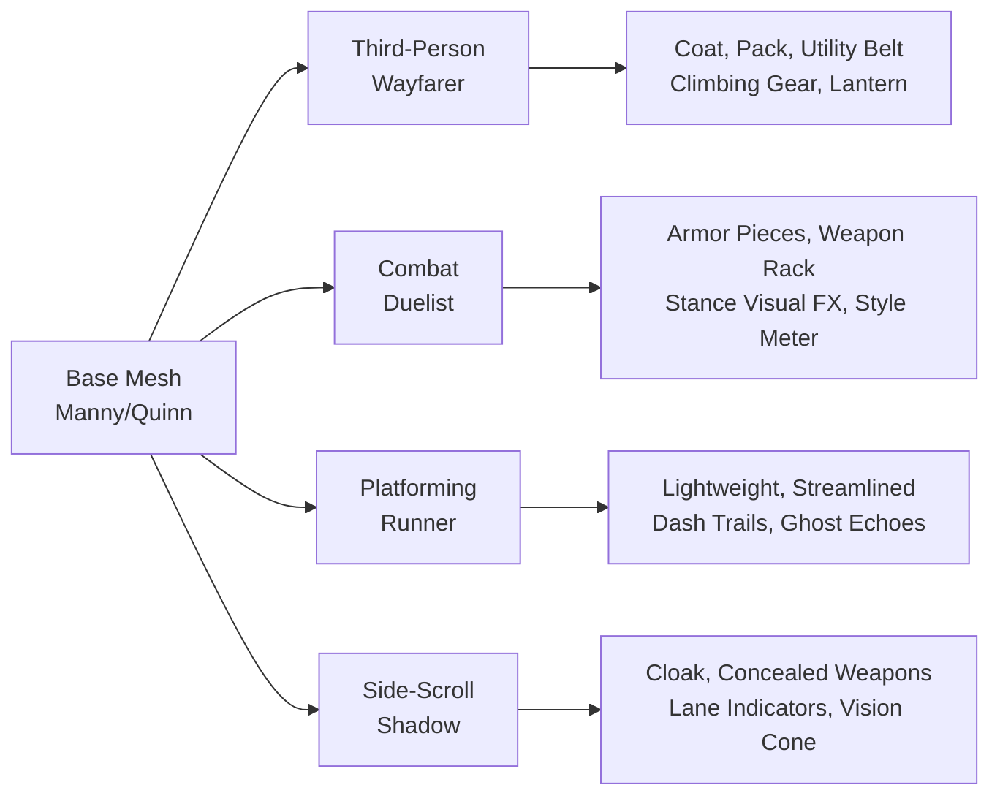
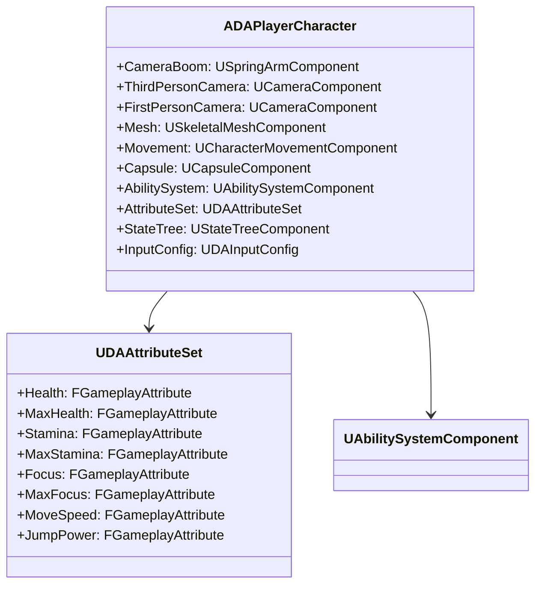
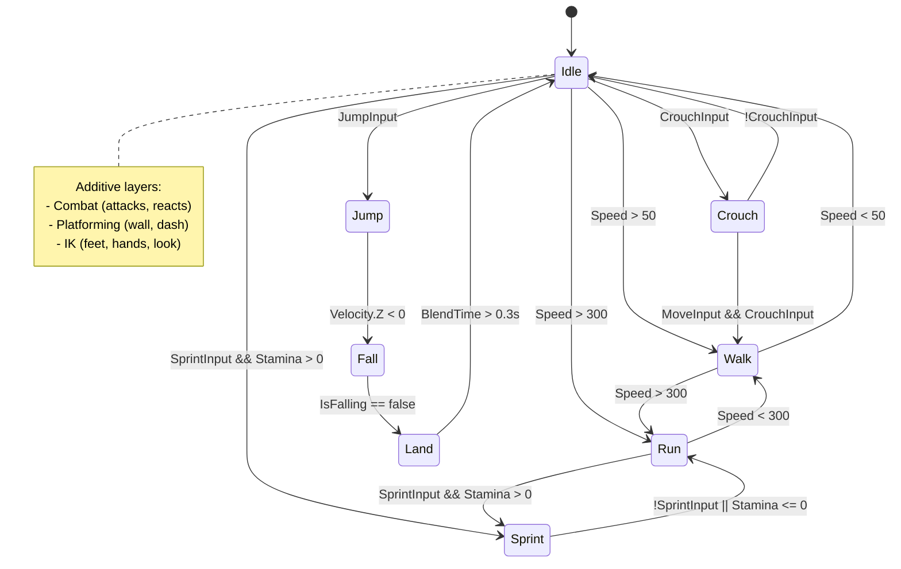

# 🎮 Game Design Document — Character Design

<div align="center">


[← Variant Designs](02-Variant-Designs.md) | [Combat Systems →](04-Combat-Systems.md)

</div>

---

## 🎭 Character Archetypes

### Base Archetype: The Drifter

> **A wandering warrior with a mysterious past, adaptable to any world.** The player character is a blank slate for projection, with customization defining their legend.

| Aspect | Description |
|--------|-------------|
| **Origin** | Unknown — revealed through gameplay/lore |
| **Motivation** | Player-defined: redemption, power, knowledge, survival |
| **Voice** | Minimal — grunts, effort sounds, rare dialogue choices |
| **Silhouette** | Recognizable at distance: coat, weapon, posture |

### Variant-Specific Archetypes

| Variant | Archetype | Fantasy |
|---------|-----------|---------|
| **Third-Person** | **Wayfarer** | Explorer, survivor, diplomat |
| **Combat** | **Duelist** | Master of arms, stylish executioner |
| **Platforming** | **Runner** | Flow state, precision, speed |
| **Side-Scroll** | **Shadow** | Stealth, precision, metroidvania explorer |

---

## 🎨 Visual Design

### Base Mesh (Shared)

| Component | Specification |
|-----------|---------------|
| **Skeleton** | UE5 Manny/Quinn compatible (Epic Skeleton) |
| **Height** | 185 cm (Manny), 170 cm (Quinn) |
| **Proportions** | Heroic: 8.5 heads, broad shoulders, narrow waist |
| **Rig** | Facial (52 blendshapes), Full body IK, Finger IK |
| **LODs** | 5 LODs: 15k → 8k → 4k → 2k → 500 tris |

### Variant Visual Differentiation



### Material System

| Layer | Description | Variant Control |
|-------|-------------|-----------------|
| **Base Color** | Skin, fabric, metal, leather | Customization |
| **Normal** | Fabric weave, metal scratches, leather grain | Shared |
| **ORM** | Occlusion, Roughness, Metallic | Shared |
| **Emissive** | Ability glow, stance indicator, health | Variant + State |
| **Damage** | Dynamic dirt, blood, scorch, tears | Gameplay-driven |

### Customization Slots

| Slot | TP | CBT | PLT | SS |
|------|-----|-----|-----|-----|
| **Head** | Hair, face, headgear | Helmet, mask, headband | Headband, goggles | Mask, hood |
| **Torso** | Coat, armor, robes | Chestplate, pauldrons | Vest, harness | Cloak, vest |
| **Arms** | Gloves, bracers | Gauntlets, wraps | Gloves, tape | Sleeves, wraps |
| **Legs** | Pants, greaves, boots | Greaves, sabatons | Tights, boots | Boots, greaves |
| **Back** | Pack, quiver, cape | Weapon rack, banner | Trail emitter | Cloak, pack |
| **Weapon** | Sheath style | Stance weapon set | N/A | Concealed |

---

## ⚙️ Technical Character Systems

### Component Architecture



### Animation Architecture

```
Animation Blueprint (ABP_DACharacter)
├── Locomotion Layer
│   ├── Grounded (Walk/Run/Sprint/Idle)
│   ├── Airborne (Jump/Fall/Land)
│   ├── Crouch/Prone
│   └── Swimming
├── Combat Layer (Additive)
│   ├── Light Attack
│   ├── Heavy Attack
│   ├── Parry/Block
│   ├── Dodge/Roll
│   └── Hit Reacts
├── Platforming Layer (Additive)
│   ├── Wall Run
│   ├── Ledge Grab/Climb
│   ├── Dash
│   └── Ground Pound
├── IK Layer (Post-Process)
│   ├── Foot Placement (Ground Alignment)
│   ├── Hand IK (Weapon, Ledges, Interact)
│   ├── Look At (Head/Spine)
│   └── Full Body (Climbing, Grappling)
└── Facial Layer
    ├── Emotion (Blink, Brow, Mouth)
    ├── Phoneme (Dialogue)
    └── Effort (Attack, Damage, Death)
```

### Animation State Machine (Simplified)



---

## 📊 Attribute System (GAS)

### Primary Attributes

| Attribute | Base | Min | Max | Regen | Description |
|-----------|------|-----|-----|-------|-------------|
| **Health** | 100 | 0 | 9999 | 0 | Life pool |
| **MaxHealth** | 100 | 1 | 9999 | 0 | Health cap |
| **Stamina** | 100 | 0 | 200 | 15/s | Movement, dodge, abilities |
| **MaxStamina** | 100 | 10 | 500 | 0 | Stamina cap |
| **Focus** | 50 | 0 | 200 | 5/s | Abilities, focus mode |
| **MaxFocus** | 50 | 10 | 500 | 0 | Focus cap |
| **Adrenaline** | 0 | 0 | 100 | 0 | Ultimate meter (Combat) |

### Derived Attributes

| Attribute | Formula | Use |
|-----------|---------|-----|
| **MoveSpeed** | `BaseWalkSpeed * (1 + SprintMult) * Mods` | MovementComponent |
| **JumpPower** | `BaseJumpZ * (1 + Mods)` | Jump velocity |
| **AirControl** | `BaseAirControl * Mods` | Mid-air maneuverability |
| **DashDistance** | `BaseDashDist * Mods` | Dash ability |
| **IFrameDuration** | `BaseIFrames * Mods` | Dodge/Parry |
| **DamageMult** | `1.0 * Mods` | Outgoing damage |
| **DamageTakenMult** | `1.0 * Mods` | Incoming damage |
| **CooldownReduction** | `0.0 * Mods` | Ability cooldowns |

### Attribute Modifiers (Gameplay Effects)

| Source | Modifies | Operation | Example |
|--------|----------|-----------|---------|
| **Gear** | MoveSpeed, DamageMult | Add/Multiply | "Boots of Speed: +20% MoveSpeed" |
| **Talents** | CooldownReduction, MaxStamina | Add | "Meditation: +10/s Stamina Regen" |
| **Buffs** | DamageMult, IFrameDuration | Multiply | "Battle Trance: 1.5x Damage, 2x IFrames" |
| **Debuffs** | MoveSpeed, JumpPower | Multiply | "Slowed: 0.5x MoveSpeed" |
| **Stances** (Combat) | All combat attrs | Override | "Power Stance: 1.3x Damage, 0.8x Speed" |

---

## 🎒 Loadout & Equipment

### Weapon System

| Variant | Weapon Slots | System |
|---------|--------------|--------|
| **Third-Person** | 2 (Main + Sidearm) | Holster swap, ammo types |
| **Combat** | 4 (Stance weapons) | Instant stance swap, unique movesets |
| **Platforming** | 0 (Movement is weapon) | N/A |
| **Side-Scroll** | 2 (Melee + Ranged) | Quick swap, distinct ammo |

### Armor/Outfit System

| Piece | Slots | Stats | Visual |
|-------|-------|-------|--------|
| **Head** | 1 | Armor, Focus, Perception | Helmet, mask, hair |
| **Chest** | 1 | Armor, Stamina, Health | Plate, coat, vest |
| **Arms** | 1 | Armor, Attack Speed, Grip | Gauntlets, wraps |
| **Legs** | 1 | Armor, MoveSpeed, Jump | Greaves, boots |
| **Back** | 1 | Utility, Storage, Mobility | Pack, cape, wings |
| **Charm** | 3 | Unique passives | Trinkets, relics |

### Set Bonuses (Example)

| Set | Pieces | 2-Piece | 4-Piece | 6-Piece |
|-----|--------|---------|---------|---------|
| **Wayfarer's** | Head, Chest, Arms, Legs, Back, Charm | +10% Stamina Regen | Vault cost 0 Stamina | Glide after vault |
| **Duelist's** | Chest, Arms, Legs, 2x Charm | +15% Parry Window | Perfect Parry = Free Heavy | Stance Swap = 0 CD |
| **Runner's** | Head, Chest, Legs, Back | +20% Air Control | Dash Resets on Kill | Infinite Wall Run |
| **Shadow's** | Head, Chest, Arms, Legs | +25% Stealth Damage | Lane Switch = Invis 1s | Execute = Full Focus |

---

## 🧬 Progression & Growth

### Leveling (Account-Wide)

| Level | Reward | Unlock |
|-------|--------|--------|
| 1-10 | Basic talents, 1 variant slot | All variants unlocked |
| 11-20 | Advanced talents, 2nd variant slot | Variant mastery tracks |
| 21-30 | Expert talents, cosmetic | Prestige currency |
| 31-40 | Master talents, legendary slot | Legendary gear access |
| 41-50 | Grandmaster, account cosmetics | Profile showcase |

### Variant Mastery (Per Variant)

| Tier | Requirement | Reward |
|------|-------------|--------|
| **Novice** | Complete tutorial | Basic loadout |
| **Adept** | 5 hours, 100 kills | Advanced talents |
| **Expert** | 20 hours, 500 kills | Mastery cosmetic |
| **Master** | 50 hours, 1000 kills | Legendary weapon skin |
| **Grandmaster** | 100 hours, all challenges | Unique title, emote |

---

## ♿ Accessibility

| Feature | Implementation |
|---------|----------------|
| **Remappable Controls** | Full keyboard/gamepad remap |
| **Assist Mode** | Infinite stamina, reduced damage, auto-climb |
| **Visual Accessibility** | High contrast, colorblind modes, UI scaling |
| **Audio Accessibility** | Subtitles, visual sound cues, mono audio |
| **Motor Accessibility** | Hold→Toggle, simplified inputs, coyote time slider |
| **Cognitive** | Objective markers, simplified UI, pause anytime |

---

## 🔗 Related Documents

| Document | Link |
|----------|------|
| **GDD Overview** | [00-Overview.md](00-Overview.md) |
| **Core Gameplay Loop** | [01-Core-Gameplay-Loop.md](01-Core-Gameplay-Loop.md) |
| **Variant Designs** | [02-Variant-Designs.md](02-Variant-Designs.md) |
| **Combat Systems** | [04-Combat-Systems.md](04-Combat-Systems.md) |
| **Level Design** | [05-Level-Design.md](05-Level-Design.md) |
| **TDD Module Design** | [../TDD/02-Module-Design.md](../TDD/02-Module-Design.md) |
| **TDD Data Flow** | [../TDD/03-Data-Flow.md](../TDD/03-Data-Flow.md) |

---

> **Art Pipeline**: Base meshes in `Content/Characters/Mannequins/`. Variant gear in `Content/Variant_*/Characters/`. Animation Blueprints in `Content/Variant_*/Anims/`. Materials use layered approach for customization.