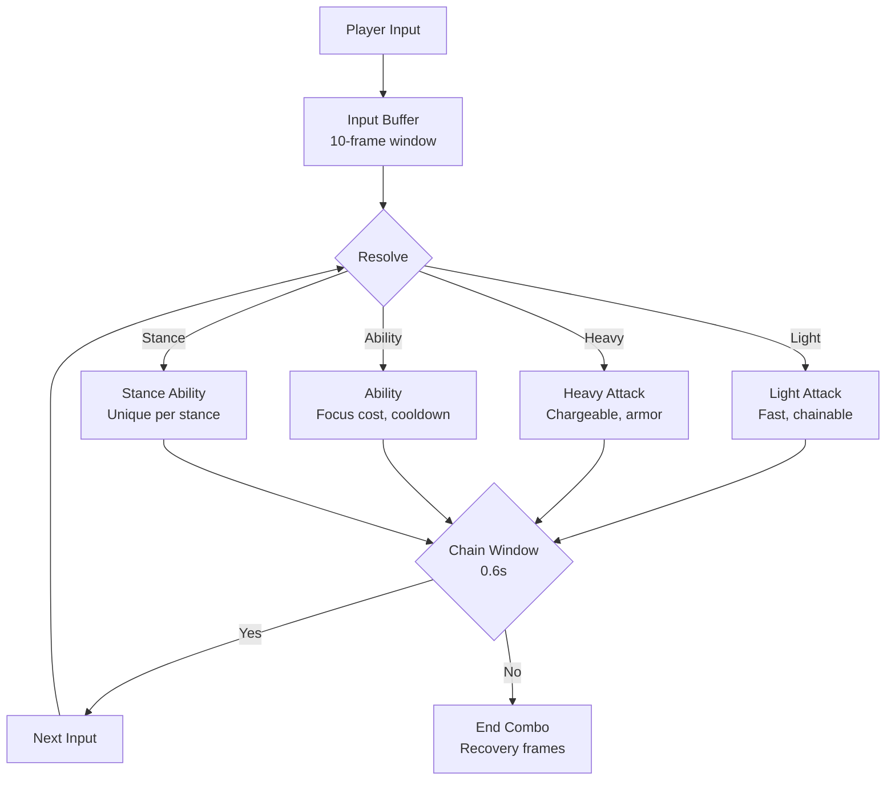
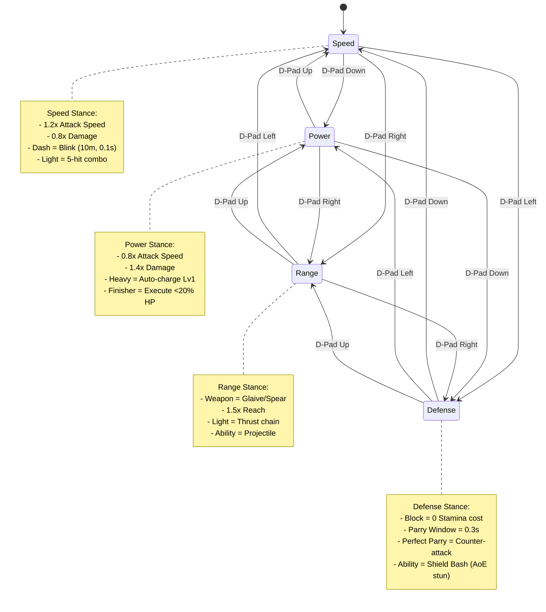

# 🎮 Game Design Document — Combat Systems

<div align="center">


[← Character Design](03-Character-Design.md) | [Level Design →](05-Level-Design.md)

</div>

---

## ⚔️ Combat Philosophy

> **"Combat as conversation"** — Every enemy attack is a question; every player response is an answer. Depth comes from the vocabulary of options, not stat checks.

### Design Principles

| Principle | Implementation |
|-----------|----------------|
| **Readability** | Clear visual/audio tells for every enemy action |
| **Agency** | Player always has a viable response option |
| **Depth** | Simple inputs, complex expressions (cancel, chain, stance) |
| **Fairness** | No unavoidable damage; all hits telegraph > 200ms |
| **Expression** | Style meter rewards creativity, not just efficiency |

---

## 🎯 Core Combat Mechanics

### Attack System



### Attack Properties

| Attack | Startup | Active | Recovery | Damage | Poise Dmg | Cancel Window | Special |
|--------|---------|--------|----------|--------|-----------|---------------|---------|
| **Light 1** | 4f | 3f | 12f | 15 | 5 | 8f | - |
| **Light 2** | 4f | 3f | 14f | 18 | 8 | 10f | Launcher |
| **Light 3** | 5f | 4f | 16f | 22 | 12 | 12f | Multi-hit |
| **Light 4 (Finisher)** | 6f | 5f | 20f | 35 | 25 | - | Knockdown |
| **Heavy (Tap)** | 12f | 6f | 24f | 35 | 30 | 10f | Armor Pierce |
| **Heavy (Lv1 Charge)** | 20f | 8f | 28f | 55 | 50 | 15f | Guard Break |
| **Heavy (Lv2 Charge)** | 35f | 10f | 32f | 85 | 80 | - | Unblockable |
| **Heavy (Lv3 Charge)** | 60f | 12f | 40f | 120 | 120 | - | Fatal (execute) |

### Defensive Mechanics

| Mechanic | Input | Window | Effect | Resource |
|----------|-------|--------|--------|----------|
| **Dodge** | Double-tap Move | 0.05s startup | I-frames 0.3s, distance 500 | 20 Stamina |
| **Perfect Dodge** | Dodge at impact | 0.1s before hit | I-frames 0.5s, slowmo 0.2s | 20 Stamina |
| **Block** | Hold LB/Q | Continuous | 50% dmg reduction, pushback | 10 Stamina/s |
| **Parry** | Tap LB/Q | 0.2s window | 0 dmg, stagger attacker, +10 Focus | 15 Stamina |
| **Perfect Parry** | Parry at exact frame | 0.05s | 0 dmg, stun 1.0s, riposte, +25 Focus | 15 Stamina |
| **Deflect** | Parry projectile | 0.15s | Reflect projectile, +15 Focus | 20 Stamina |

### Stance System (Combat Variant Only)



### Stance Abilities (4 per stance, 16 total)

| Stance | Slot 1 | Slot 2 | Slot 3 | Slot 4 (Ultimate) |
|--------|--------|--------|--------|-------------------|
| **Speed** | Whirlwind Slash | Shadow Step | Thousand Cuts | **Gale Dance** (AoE, 100 hits) |
| **Power** | Seismic Slam | Mountain Splitter | Titan's Grip | **World Breaker** (Line, execute) |
| **Range** | Piercing Shot | Volley | Skyfall | **Starfall** (AoE, homing) |
| **Defense** | Shield Bash | Aegis Wall | Retribution | **Absolute Guard** (Invuln 5s) |

---

## 🧠 Enemy AI & Behavior

### StateTree Architecture

```
Enemy StateTree (ST_Enemy_Base)
├── Root Selector
│   ├── Death (HP <= 0)
│   ├── Stun/Stagger (Posture broken)
│   ├── Combat Selector
│   │   ├── Boss Phase Selector (if Boss)
│   │   ├── Engage (In range, LOS)
│   │   │   ├── Melee Selector
│   │   │   │   ├── Combo Attack (Weight: 40)
│   │   │   │   ├── Single Attack (Weight: 30)
│   │   │   │   ├── Feint → Attack (Weight: 15)
│   │   │   │   └── Retreat → Attack (Weight: 15)
│   │   │   ├── Ranged Selector (if capable)
│   │   │   │   ├── Shoot (Weight: 50)
│   │   │   │   ├── Strafe Shoot (Weight: 30)
│   │   │   │   └── Reload (Weight: 20)
│   │   │   └── Ability Selector (if Focus > 50)
│   │   │       ├── Offensive Ability
│   │   │       ├── Defensive Ability
│   │   │       └── Utility Ability
│   │   ├── Approach (Out of range)
│   │   │   ├── Walk → Run → Sprint
│   │   │   ├── Flank (if player stationary)
│   │   │   └── Seek Cover (if ranged)
│   │   └── Idle/Wait (Combat timer)
│   ├── Investigate (Noise, ally death)
│   │   ├── Move to last known
│   │   ├── Search pattern
│   │   └── Return to patrol
│   └── Patrol (Default)
│       ├── Waypoint sequence
│       ├── Idle at points
│       └── React to stimuli
```

### Enemy Archetype Data

| Archetype | HP | Poise | Speed | Attacks | Abilities | Weakness |
|-----------|-----|-------|-------|---------|-----------|----------|
| **Grunt** | 100 | 20 | Fast | 2-hit combo | - | Any |
| **Heavy Grunt** | 250 | 60 | Slow | 1-hit heavy | Ground Slam | Parry, Backstab |
| **Shield Bearer** | 300 | 100 | Slow | Shield Bash | Block, Charge | Flank, Heavy Break |
| **Archer** | 80 | 10 | Medium | Shoot, Kick | Volley, Poison Arrow | Close Gap, Deflect |
| **Mage** | 120 | 15 | Slow | Magic Bolt | Fireball, Shield, Teleport | Interrupt, Rush |
| **Berserker** | 400 | 200 | Fast | 3-hit hyper | Rage Mode, Leap | Parry, Dodge, Stagger |
| **Assassin** | 150 | 30 | Very Fast | Dual Blades | Vanish, Backstab | Awareness, Area Denial |
| **Commander** | 500 | 150 | Medium | Polearm | Rally, Formation, Banner | Disrupt Banner, Focus Fire |

### Boss Design Template

| Phase | HP % | New Mechanics | Arena Changes |
|-------|------|---------------|---------------|
| **1** | 100-70% | Base moveset | Standard |
| **2** | 70-40% | +1 Ability, +Armor | Hazards spawn |
| **3** | 40-15% | +2 Abilities, Phase Shift | Arena transforms |
| **4** | 15-0% | Desperation Move, Enrage | Full hazard, time limit |

---

## 💥 Damage & Numbers

### Damage Calculation

```cpp
// Simplified formula (implemented in UDACombatStatics)
float CalculateFinalDamage(float BaseDamage, FDamageContext Context)
{
    float Damage = BaseDamage;
    
    // Attacker modifiers
    Damage *= Context.Attacker->GetDamageMultiplier();        // Buffs, talents, gear
    Damage *= Context.Attacker->GetStanceDamageMultiplier();  // Stance bonus
    Damage *= Context.ComboMultiplier;                        // Combo scaling
    Damage *= Context.CriticalMultiplier;                     // Crit (1.5x base)
    
    // Defender modifiers
    Damage *= (1.0f - Context.Defender->GetDamageReduction()); // Armor, buffs
    Damage *= Context.Defender->GetIncomingDamageMultiplier(); // Debuffs
    
    // Type effectiveness
    Damage *= GetTypeEffectiveness(Context.DamageType, Context.Defender->GetArmorType());
    
    // Random variance (±5%)
    Damage *= FMath::FRandRange(0.95f, 1.05f);
    
    return FMath::Max(1.0f, Damage);
}
```

### Damage Types & Effectiveness

| Damage Type | vs Light | vs Medium | vs Heavy | vs Supernatural | Status Effect |
|-------------|----------|-----------|----------|-----------------|---------------|
| **Physical** | 1.0x | 1.0x | 0.8x | 1.0x | Bleed |
| **Slash** | 1.2x | 1.0x | 0.7x | 1.0x | Deep Wound |
| **Pierce** | 1.0x | 1.2x | 1.3x | 0.8x | Puncture |
| **Blunt** | 0.8x | 1.0x | 1.3x | 1.0x | Stun |
| **Fire** | 1.0x | 1.0x | 1.0x | 1.5x | Burn |
| **Ice** | 1.0x | 1.0x | 1.0x | 1.2x | Freeze/Slow |
| **Lightning** | 1.2x | 1.0x | 1.0x | 1.3x | Shock |
| **Poison** | 1.0x | 1.0x | 1.0x | 0.8x | Poison (DoT) |
| **Holy** | 0.8x | 1.0x | 1.0x | 2.0x | Purify |
| **Dark** | 1.0x | 1.2x | 1.0x | 1.5x | Curse |

### Damage Numbers UI

| Number Type | Color | Size | Behavior |
|-------------|-------|------|----------|
| **Normal** | White | 24pt | Float up, fade |
| **Critical** | Yellow | 32pt | Pop, scale, float |
| **Weakness** | Orange | 28pt | Pulse, float |
| **Resist** | Gray | 20pt | Small, quick fade |
| **Immune** | Red + ❌ | 24pt | Shake, no float |
| **Heal** | Green | 24pt | Float up, pulse |
| **Focus Gain** | Blue | 20pt | Float to Focus bar |
| **Stamina** | Yellow | 18pt | Float to Stamina bar |

---

## 🎭 Hit Reaction & Feedback

### Hit Pause (Frame Freeze)

| Attack Type | Hit Pause | Screen Shake | Camera Effect |
|-------------|-----------|--------------|---------------|
| Light | 0.04s (2f) | Light (0.1) | Micro-shake |
| Heavy | 0.08s (4f) | Medium (0.2) | Pulse + FOV |
| Finisher | 0.12s (6f) | Heavy (0.4) | Dramatic zoom |
| Perfect Parry | 0.10s (5f) | Sharp (0.3) | Flash + Slowmo 0.2s |
| Ultimate | 0.20s (10f) | Massive (0.6) | Time stop + Chromatic aberration |

### Hit Reaction Types

| Reaction | Trigger | Animation | Gameplay Effect |
|----------|---------|-----------|-----------------|
| **Light Flinch** | Light hit, >0 Poise | Upper body recoil | None |
| **Heavy Stagger** | Heavy hit, >50% Poise | Full body stagger | 0.5s vulnerable |
| **Knockback** | Heavy finisher, >75% Poise | Launched back | Air state, techable |
| **Knockdown** | Finisher, broken Poise | Fall down | 2s grounded, invuln 1s |
| **Launch** | Launcher hit | Upward arc | Aerial comboable |
| **Wall Splat** | Knockback into wall | Flatten against wall | Extended stun, slide down |
| **Crumple** | Vital hit (head, back) | Slow collapse | 3s vulnerable, execution |
| **Execution** | <20% HP, heavy finisher | Unique per enemy | Instant kill, style bonus |

---

## 🎨 Visual & Audio Feedback

### VFX Tags (Niagara)

| Tag | System | Parameters |
|-----|--------|------------|
| **Hit.Light** | Spark_01 | Size: 0.5, Life: 0.2s, Color: Weapon |
| **Hit.Heavy** | Impact_Heavy | Size: 1.0, Life: 0.4s, Debris: Yes |
| **Hit.Critical** | Crit_Burst | Size: 1.5, Life: 0.6s, Glow: Yes |
| **Hit.Element.Fire** | Fire_Splash | Size: 1.0, Life: 0.5s, Heat Distortion |
| **Hit.Element.Ice** | Ice_Shatter | Size: 1.2, Life: 0.3s, Frost Trail |
| **Parry.Success** | Parry_Flash | Size: 2.0, Life: 0.15s, Screen Flash |
| **Parry.Perfect** | Parry_Perfect | Size: 3.0, Life: 0.3s, Time Stop VFX |
| **Dodge** | Dash_Afterimage | Trail: 5 frames, Fade: 0.2s |
| **Stance.Swap** | Stance_Shift | Burst: Stance Color, Sound: Stance Voice |

### Audio Layers

| Layer | Content | Dynamic |
|-------|---------|---------|
| **Impact** | Weapon-type specific (sword, blunt, fist) | Velocity, Material |
| **Body** | Flesh, armor, shield, supernatural | Damage Type, Body Part |
| **Effort** | Player grunts, enemy vocals | Stamina, Health % |
| **Environment** | Debris, ground, wall impact | Surface, Force |
| **UI** | Hit confirm, crit, weakness, resist | Volume: Master * SFX * HitConfirm |

---

## 🔗 Related Documents

| Document | Link |
|----------|------|
| **GDD Overview** | [00-Overview.md](00-Overview.md) |
| **Core Gameplay Loop** | [01-Core-Gameplay-Loop.md](01-Core-Gameplay-Loop.md) |
| **Variant Designs** | [02-Variant-Designs.md](02-Variant-Designs.md) |
| **Character Design** | [03-Character-Design.md](03-Character-Design.md) |
| **Level Design** | [05-Level-Design.md](05-Level-Design.md) |
| **TDD Architecture** | [../TDD/01-Architecture.md](../TDD/01-Architecture.md) |
| **TDD Module Design** | [../TDD/02-Module-Design.md](../TDD/02-Module-Design.md) |
| **TDD Networking** | [../TDD/04-Networking.md](../TDD/04-Networking.md) |

---

> **Implementation**: Combat logic in `Source/DACharacters/Private/DACombatComponent.cpp` (to be created). Abilities via GAS in `Source/DA/Abilities/`. StateTrees in `Content/Variant_Combat/Blueprints/AI/`. VFX in `Content/Variant_Combat/VFX/`. Audio in `Content/Variant_Combat/Audio/`.