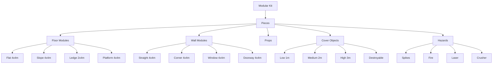

# 🎮 Game Design Document — Level Design

<div align="center">


[← Combat Systems](04-Combat-Systems.md) | [Back to GDD Overview](00-Overview.md)

</div>

---

## 🏗 Level Design Philosophy

> **"Levels as gameplay instruments"** — Every space teaches, tests, and rewards player mastery. No filler; every encounter, platform, and vista serves the core loop.

### Universal Principles

| Principle | Application |
|-----------|-------------|
| **Readability** | Clear affordances: climbable = distinct material, jumpable = clear height |
| **Flow** | Movement rhythm: action → recovery → action (3-5 sec cycles) |
| **Choice** | Multiple valid paths: stealth, combat, traversal, puzzle |
| **Pacing** | Tension → Release → Tension (combat → exploration → combat) |
| **Mastery** | First pass: survival. Second: optimization. Third: speedrun. |

---

## 🌍 Variant Level Languages

### Third-Person: Open World Zones

```
Zone Structure (per biome)
├── Hub Town (Safe, services, quests)
│   ├── Fast Travel Point
│   ├── Crafting/Upgrade Stations
│   └── Social/Info NPCs
├── Main Path (Critical Path)
│   ├── 3-5 Story Beats per Zone
│   ├── Gated by Abilities (Metroidvania)
│   └── Setpiece Moments (Boss, Vistas)
├── POI Clusters (3-5 per Zone)
│   ├── Enemy Camp (Combat)
│   ├── Ruins (Exploration/Lore)
│   ├── Cave/Dungeon (Platforming/Puzzle)
│   ├── World Event (Dynamic)
│   └── Vistas (Photo/Navigation)
└── Wilds (Emergent)
    ├── Roaming Enemies
    ├── Resource Nodes
    ├── Hidden Secrets
    └── Travel Routes (Roads, Zip Lines)
```

#### Zone Metrics

| Metric | Target | Notes |
|--------|--------|-------|
| **Zone Size** | 2-4 km² | 10-15 min traverse |
| **POI Density** | 1 per 0.2 km² | Visible from main path |
| **Vertical Layers** | 3-5 | Ground, Ruins, Cliffs, Canopy, Sky |
| **Travel Time** | 2-3 min between POIs | Fast travel unlocks after visit |
| **Enemy Density** | 15-25 per zone | Scales with player level |
| **Secrets** | 10-15 per zone | Reward: lore, cosmetics, upgrades |

#### Landmark Hierarchy

```
Tier 1: Zone Landmark (Visible from anywhere)
    │   Examples: Massive Tree, Volcano, Citadel, World Tree
    │   Function: Navigation anchor, zone identity
    │
    ├── Tier 2: Region Landmarks (Visible within region)
    │   Examples: Waterfall, Bridge, Ruin, Watchtower
    │   Function: Sub-area navigation, POI markers
    │
    └── Tier 3: Local Landmarks (Visible nearby)
        Examples: Unique Tree, Rock Formation, Campfire
        Function: Micro-navigation, checkpoint reference
```

### Combat: Encounter Arenas

```
Arena Template
├── Entry Zone (Safe, 3-5s observation)
│   ├── Cover: 2-3 pieces
│   ├── Intel: Enemy patrol visible
│   └── Options: Stealth, Direct, Flank
├── Combat Zone (Primary fight)
│   ├── Size: 30m diameter (scales: 20m/40m)
│   ├── Cover: 40% coverage, varied height
│   ├── Verticality: 2-3 levels (ground, platforms, high ground)
│   ├── Hazards: 1-2 (explosive, environmental)
│   └── Exits: 2-3 (retreat, reposition)
├── Flank Routes (2 per arena)
│   ├── Stealth approach
│   ├── High ground access
│   └── Rear entry
└── Post-Combat (Reward)
    ├── Loot chest (visible)
    ├── Resource nodes
    └── Path forward (unlocked)
```

#### Arena Archetypes

| Archetype | Layout | Best For | Variants |
|-----------|--------|----------|----------|
| **Circular** | Center focus, radial cover | Horde, Boss | CBT, TP |
| **Linear** | Corridor, advancing | Gauntlet, Escort | SS, CBT |
| **Vertical** | Multi-tier, climbable | Aerial, Mobility | PLT, TP |
| **Arena** | Symmetrical, balanced | Duel, PvP | CBT, SS |
| **Maze** | Interconnected, choice | Stealth, Puzzle | TP, SS |
| **Open** | Minimal cover, mobility | Skirmish, Mounted | TP, CBT |

### Platforming: Challenge Screens

```
Screen Template (Single-screen challenge)
├── Entry (Safe, 1-2s)
│   ├── Checkpoint (instant respawn)
│   ├── Visual: Full screen preview
│   └── Ghost: Best run replay
├── Rhythm Section (3-5 beats)
│   ├── Beat 1: Intro mechanic (teach)
│   ├── Beat 2: Variation (test)
│   ├── Beat 3: Combination (mastery)
│   ├── Beat 4: Twist (surprise)
│   └── Beat 5: Climax (skill check)
├── Optional Path (Harder, reward)
│   ├── Collectible: Strawberry/Token
│   ├── Time Trial: Ghost target
│   └── No-Dash: Pure movement
└── Exit (Safe, 1s)
    ├── Checkpoint
    ├── Transition to next
    └── Progress indicator
```

#### Screen Difficulty Curve

| World | Screens | New Mechanics | Difficulty |
|-------|---------|---------------|------------|
| **1: Basics** | 15 | Jump, Dash, Wall Jump | ★☆☆☆☆ |
| **2: Momentum** | 20 | Slopes, Curves, Speed | ★★☆☆☆ |
| **3: Verticality** | 20 | Wall Run, Ledge Grab | ★★★☆☆ |
| **4: Precision** | 20 | Spike Jumps, Timing | ★★★★☆ |
| **5: Mastery** | 15 | All Combined, Speedrun | ★★★★★ |
| **B-Side** | 10/World | Remix, Harder | ★★★★★+ |

### Side-Scrolling: Room-Based Metroidvania

```
World Structure
├── Surface (Starting Area)
│   ├── Tutorial Rooms (5)
│   ├── Hub: Safe Town
│   └── Gate: Requires Ability A
├── Biome 1: Caverns (Earth)
│   ├── Rooms: 15-20
│   ├── Ability: Dash
│   ├── Boss: Earth Golem
│   └── Gate: Requires Ability B
├── Biome 2: Jungle (Nature)
│   ├── Rooms: 15-20
│   ├── Ability: Wall Jump
│   ├── Boss: Jungle Guardian
│   └── Gate: Requires Ability C
├── Biome 3: Ruins (Tech)
│   ├── Rooms: 20-25
│   ├── Ability: Double Jump
│   ├── Boss: Ancient Machine
│   └── Gate: Requires Ability D
├── Biome 4: Void (Cosmic)
│   ├── Rooms: 15-20
│   ├── Ability: Phase Shift
│   ├── Boss: Void Entity
│   └── Gate: Final Area
└── Core: Heart of World
    ├── Rooms: 10
    ├── All Abilities Required
    └── Final Boss
```

#### Room Types

| Type | Count/Biome | Purpose | Metrics |
|------|-------------|---------|---------|
| **Combat** | 6-8 | Enemy encounter | 1-3 waves, 30-60s |
| **Platforming** | 4-6 | Movement challenge | 2-4 screens |
| **Puzzle** | 2-3 | Logic/Environment | 1-3 min solve |
| **Secret** | 2-4 | Hidden reward | Breakable wall, false floor |
| **Upgrade** | 1-2 | Ability/Stat gain | Chozo statue, Terminal |
| **Save/Shop** | 1-2 | Safe, services | Bench, Vendor |
| **Transition** | 2-3 | Biome connection | Elevator, Tunnel, Teleporter |
| **Boss** | 1 | Major encounter | 3-5 min, Multi-phase |

#### Map & Navigation

```
Map System (Metroidvania)
├── Fog of War (Revealed by proximity)
├── Room Icons
│   ├── □ Unexplored
│   ├── ■ Explored
│   ├── ◆ Save Point
│   ├── ♦ Shop
│   ├── ☆ Upgrade
│   ├── ☠ Boss
│   └── ? Secret (Revealed after find)
├── Ability Gates (Color-coded)
│   ├── Red: Dash
│   ├── Blue: Wall Jump
│   ├── Green: Double Jump
│   ├── Yellow: Phase
│   └── Purple: Ultimate
├── Fast Travel (Unlock at Save Points)
└── Completion % (Rooms, Items, Secrets)
```

---

## 📐 Technical Level Construction

### Modular Kit System



### Grid & Snap Settings

| Variant | Grid Size | Snap Angle | Height Step |
|---------|-----------|------------|-------------|
| **Third-Person** | 100 cm | 15° | 50 cm |
| **Combat** | 100 cm | 15° | 50 cm |
| **Platforming** | 50 cm | 45° | 25 cm |
| **Side-Scroll** | 100 cm | 90° | 100 cm |

### Level Streaming

```
Streaming Strategy
├── Always Loaded
│   ├── Persistent Level (GameMode, PlayerStart, Lighting)
│   ├── Global Systems (Audio, Weather, Time)
│   └── Hub Areas (Towns, Safe Zones)
├── Distance-Based (Third-Person)
│   ├── Zone Cells (2km² each)
│   ├── Load Radius: 1 cell + neighbors
│   ├── Priority: Player → Camera → AI
│   └── Unload: 2 cells away
├── Room-Based (Side-Scroll)
│   ├── Current Room + Adjacent
│   ├── Preload: Next 2 rooms in direction
│   └── Unload: Behind 2 rooms
├── Screen-Based (Platforming)
│   ├── Current Screen + Next
│   ├── Instant Load (Small)
│   └── No Unload (Session persistent)
└── Combat Arenas
    ├── Load on Trigger Entry
    ├── Keep Loaded During Combat
    └── Unload 30s After Clear
```

---

## 🎨 Visual Language & Affordances

### Material Coding (Universal)

| Material | Meaning | Visual |
|----------|---------|--------|
| **Yellow/Gold** | Climbable, Interactive | Bright, glowing edges |
| **Blue** | Dash-through, Phase | Pulsing, translucent |
| **Red** | Hazard, Damage | Glowing, warning stripes |
| **Green** | Heal, Safe, Beneficial | Soft glow, particles |
| **Purple** | Magic, Supernatural | Shimmer, distortion |
| **White/Gray** | Neutral, Standard | Matte, clean |
| **Orange** | Breakable, Destructible | Cracks, debris preview |

### Lighting for Gameplay

| Situation | Lighting Approach |
|-----------|-------------------|
| **Critical Path** | Brighter, warm key light, rim on ledges |
| **Secrets** | Subtle highlight, particle hint, audio cue |
| **Combat Arena** | High contrast, clear shadows, no blind spots |
| **Platforming** | Consistent, no flicker, clear depth |
| **Stealth** | Shadows = concealment, light = exposure |
| **Boss Arena** | Thematic, dramatic, phase changes |

---

## 🧪 Playtesting & Metrics

### Playtest Checklist

| Test | Method | Success Criteria |
|------|--------|------------------|
| **First Play** | Fresh player, no guidance | Reach checkpoint in < 3 tries |
| **Flow Test** | Speedrunner | Consistent rhythm, no stops |
| **Combat Test** | Combat designer | All archetypes viable, no cheese |
| **Accessibility** | Assist mode enabled | Completable with all assists |
| **Performance** | Profiler on target hardware | 60 FPS, < 2ms GPU spikes |
| **Readability** | Grayscale mode | All affordances visible |

### Telemetry Events

```json
{
  "event": "level_checkpoint",
  "level": "Biome1_Caverns",
  "checkpoint": "CP_03",
  "time": 145.2,
  "deaths": 2,
  "variant": "SideScroll",
  "abilities": ["Dash", "WallJump"]
}
```

| Event | Purpose |
|-------|---------|
| `level_start` | Funnel entry |
| `checkpoint_reached` | Progress pacing |
| `death` | Difficulty spikes |
| `ability_used` | Mechanic usage |
| `secret_found` | Exploration reward |
| `combat_encounter_start/end` | Fight pacing |
| `level_complete` | Completion rate |

---

## 🔗 Related Documents

| Document | Link |
|----------|------|
| **GDD Overview** | [00-Overview.md](00-Overview.md) |
| **Core Gameplay Loop** | [01-Core-Gameplay-Loop.md](01-Core-Gameplay-Loop.md) |
| **Variant Designs** | [02-Variant-Designs.md](02-Variant-Designs.md) |
| **Character Design** | [03-Character-Design.md](03-Character-Design.md) |
| **Combat Systems** | [04-Combat-Systems.md](04-Combat-Systems.md) |
| **TDD Architecture** | [../TDD/01-Architecture.md](../TDD/01-Architecture.md) |
| **TDD Data Flow** | [../TDD/03-Data-Flow.md](../TDD/03-Data-Flow.md) |
| **TDD Performance** | [../TDD/05-Performance.md](../TDD/05-Performance.md) |

---

> **Level Assets**: Modular kits in `Content/LevelPrototyping/`. Variant levels in `Content/Variant_*/Lvl_*.umap`. Streaming volumes in level. Lighting scenarios in `Config/LightingScenarios/`.