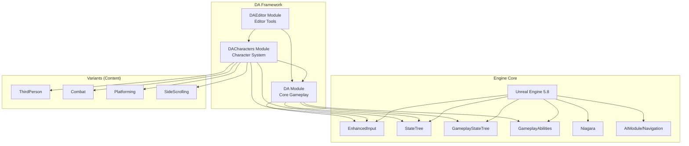
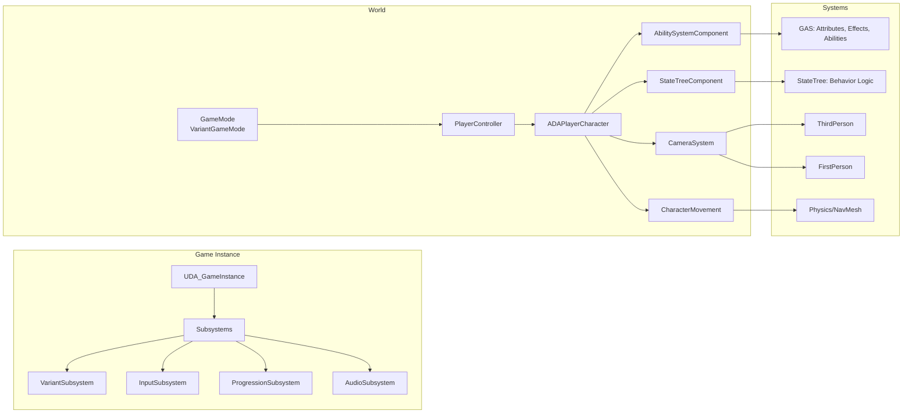
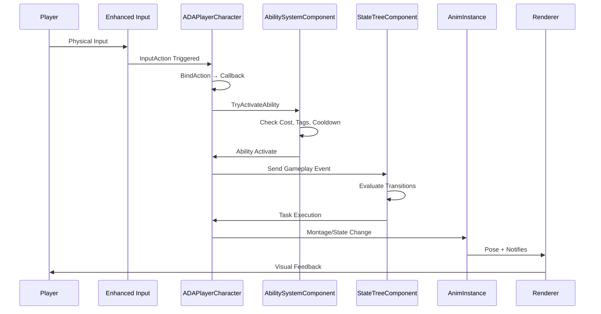

# 🔧 Technical Design Document — Overview

<div align="center">


[← Wiki Home](../Wiki/Home.md) | [Architecture →](01-Architecture.md)

</div>

---

## 🎯 Technical Vision

> **Build a maintainable, performant, and extensible gameplay framework that serves as the foundation for multiple action game variants. Prioritize clean architecture, data-driven design, and engine-native patterns.**

### Technical Pillars

| Pillar | Goal | Metric |
|--------|------|--------|
| **Modularity** | Independent modules, clear boundaries | < 5 cross-module deps |
| **Performance** | 60 FPS on GTX 1060 / Ryzen 5 3600 | < 16ms frame, < 8ms GPU |
| **Scalability** | Support 100+ concurrent actors | < 5ms gameplay thread |
| **Maintainability** | Clear ownership, low coupling | < 20 min new dev onboarding |
| **Extensibility** | Variant/plugin architecture | New variant in < 1 week |

---

## 🏗 High-Level Architecture

### Module Dependency Graph



### Runtime Architecture



---

## 🧩 Core Systems Overview

### 1. Enhanced Input System
- **Input Actions** (`UInputAction`): Atomic inputs (Move, Jump, Attack)
- **Mapping Contexts** (`UInputMappingContext`): Variant-specific bindings
- **Triggers** (`UInputTrigger`): Started, Ongoing, Completed, Custom
- **Modifiers** (`UInputModifier`): Dead zone, scaling, swipe, hold

### 2. Camera System
- **Dual Camera**: FirstPerson + ThirdPerson (SpringArm)
- **Blend Manager**: Smooth transitions, FOV interpolation
- **Variant Config**: Distance, FOV, offsets, collision per variant
- **Photo Mode**: Free camera, filters, DOF, export

### 3. Character Controller
- **Base**: `ADACharacterBase` (ACharacter) — Jump, basic movement
- **Player**: `ADAPlayerCharacter` — Input, Camera, Abilities, StateTree
- **Movement**: Extended `UCharacterMovementComponent` — Variant tuning
- **Animation**: Layered AnimBP — Locomotion + Additives + IK

### 4. Gameplay Ability System (GAS)
- **Attributes**: Health, Stamina, Focus, Adrenaline, Derived
- **Effects**: Instant, Duration, Infinite, Periodic, Executions
- **Abilities**: Active, Passive, Triggered, Cancellable
- **Cues**: GameplayCues (VFX/SFX) — Decoupled from logic

### 5. StateTree Framework
- **Schema**: Data-driven state definition
- **Evaluators**: Conditions, Selectors, Tasks
- **Tasks**: Actions, Latent, Parallel
- **Binding**: Blueprint/C++ evaluators and tasks

### 6. Variant Management
- **Subsystem**: `UDAVariantSubsystem` — Load/unload variant config
- **Config**: JSON-driven (`Config/Variants/*.json`)
- **Activation**: GameMode → VariantCharacterClass + Context + StateTree
- **Hot-Swap**: Runtime variant switch (debug/development)

---

## 📁 Source Structure

```
Source/
├── DA/                          # Core Runtime Module
│   ├── Public/
│   │   ├── DA.h                 # Module header
│   │   ├── DACharacter.h        # DEPRECATED → DACharacterBase
│   │   ├── DAGameMode.h
│   │   ├── DAPlayerController.h
│   │   ├── DAAttributeSet.h     # GAS Attributes
│   │   ├── DACombatInterface.h  # Combat interaction
│   │   ├── DAInputConfig.h      # Input data asset
│   │   ├── DAVariantSubsystem.h # Variant management
│   │   └── DAProgressionSubsystem.h
│   ├── Private/
│   │   ├── DA.cpp
│   │   ├── DACharacter.cpp
│   │   ├── DAGameMode.cpp
│   │   ├── DAPlayerController.cpp
│   │   ├── DAAttributeSet.cpp
│   │   ├── DAInputConfig.cpp
│   │   ├── DAVariantSubsystem.cpp
│   │   └── DAProgressionSubsystem.cpp
│   └── DA.Build.cs
│
├── DACharacters/                # Character System Module
│   ├── Public/
│   │   ├── DACharacters.h
│   │   ├── DACharacterBase.h    # Base character class
│   │   ├── DAPlayerCharacter.h  # Player character
│   │   ├── DACharacterMovementComponent.h
│   │   ├── DACameraComponent.h
│   │   └── DAAnimInstance.h
│   ├── Private/
│   │   ├── DACharacters.cpp
│   │   ├── DACharacterBase.cpp
│   │   ├── DAPlayerCharacter.cpp
│   │   ├── DACharacterMovementComponent.cpp
│   │   ├── DACameraComponent.cpp
│   │   └── DAAnimInstance.cpp
│   └── DACharacters.Build.cs
│
├── DAEditor/                    # Editor Module
│   ├── Public/
│   │   ├── DAEditor.h
│   │   ├── VariantConfigEditor.h
│   │   ├── InputMappingVisualizer.h
│   │   └── StateTreeDebugger.h
│   ├── Private/
│   │   ├── DAEditor.cpp
│   │   ├── VariantConfigEditor.cpp
│   │   ├── InputMappingVisualizer.cpp
│   │   └── StateTreeDebugger.cpp
│   └── DAEditor.Build.cs
│
├── DA.Target.cs                 # Runtime Target
└── DAEditor.Target.cs           # Editor Target
```

---

## 🔄 Data Flow Overview



---

## 🛠 Technology Stack

| Category | Technology | Version | Purpose |
|----------|------------|---------|---------|
| **Engine** | Unreal Engine | 5.8 | Core framework |
| **Language** | C++ | C++20 | Gameplay systems |
| **Scripting** | Blueprint | - | Designer iteration |
| **Build** | UnrealBuildTool | .NET 8 | Compilation |
| **IDE** | Visual Studio | 2022 17.8+ | Development |
| **Version Control** | Git + LFS | 2.45+ | Source control |
| **CI/CD** | GitHub Actions | - | Automation |
| **Static Analysis** | clang-format, IWYU | - | Code quality |
| **Documentation** | Doxygen + Mermaid | - | API docs |
| **Profiling** | Unreal Insights | - | Performance |
| **Testing** | Automation System | - | Unit/Integration |

---

## 📦 Build Configurations

| Config | Use Case | Optimizations | Debug Info |
|--------|----------|---------------|------------|
| **Debug** | Development debugging | None | Full |
| **DebugGame** | Gameplay debugging | Minimal | Full |
| **Development** | Daily development | Speed | Line tables |
| **Shipping** | Release builds | Maximum | None |
| **Test** | Automated testing | Speed | Line tables |

### Module Build Settings (DA.Build.cs example)

```csharp
public class DA : ModuleRules
{
    public DA(ReadOnlyTargetRules Target) : base(Target)
    {
        PCHUsage = PCHUsageMode.UseExplicitOrSharedPCHs;
        
        PublicDependencyModuleNames.AddRange(new string[] {
            "Core", "CoreUObject", "Engine", "InputCore",
            "EnhancedInput", "GameplayAbilities", "GameplayTags",
            "GameplayTasks", "StateTree", "GameplayStateTree",
            "AIModule", "NavigationSystem", "Niagara"
        });
        
        PrivateDependencyModuleNames.AddRange(new string[] {
            "Slate", "SlateCore", "UMG", "DeveloperSettings"
        });
        
        // C++20
        CppStandard = CppStandardVersion.Cpp20;
        
        // Optimizations
        if (Target.Configuration != UnrealTargetConfiguration.Debug)
        {
            bUseUnityBuild = true;
            bUsePCHFiles = true;
        }
    }
}
```

---

## 🎯 Performance Budgets

| System | Frame Budget | Memory Budget | Notes |
|--------|--------------|---------------|-------|
| **Gameplay Thread** | 8ms | 512 MB | Logic, AI, Ability |
| **Render Thread** | 8ms | 1 GB | Draw, Mesh, Material |
| **GPU** | 16ms | 2 GB | Shaders, Post-process |
| **Animation** | 2ms | 256 MB | Evaluation, Montages |
| **Physics** | 1ms | 128 MB | Collision, Ragdoll |
| **Audio** | 1ms | 64 MB | Voices, DSP |
| **Network** | 2ms | 64 MB | Replication, RPC |
| **Total** | **16.67ms (60 FPS)** | **~4 GB** | Target: 1080p/60 |

---

## 🔗 Related Documents

| Document | Link |
|----------|------|
| **Architecture** | [01-Architecture.md](01-Architecture.md) |
| **Module Design** | [02-Module-Design.md](02-Module-Design.md) |
| **Data Flow** | [03-Data-Flow.md](03-Data-Flow.md) |
| **Networking** | [04-Networking.md](04-Networking.md) |
| **Performance** | [05-Performance.md](05-Performance.md) |
| **GDD Overview** | [../GDD/00-Overview.md](../GDD/00-Overview.md) |
| **ADR Index** | [../ADR/Index.md](../ADR/Index.md) |

---

> **Architecture Decisions**: All major technical decisions documented in [ADR](../ADR/Index.md). Key decisions: C++20, Enhanced Input over legacy, StateTree over Behavior Trees, GAS for abilities, Data-driven variants.