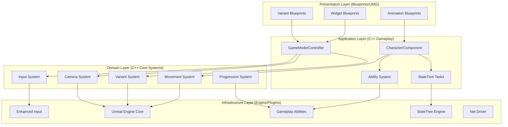
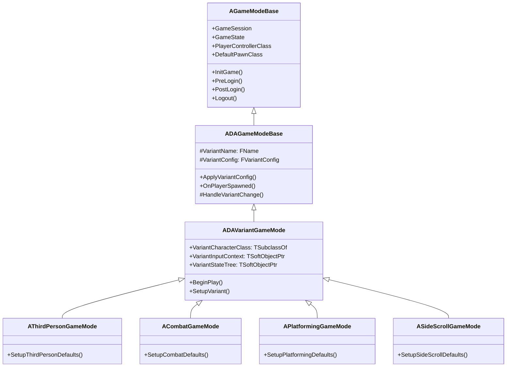

# 🔧 Technical Design Document — Architecture

<div align="center">


[← TDD Overview](00-Overview.md) | [Module Design →](02-Module-Design.md)

</div>

---

## 🏛 Architectural Patterns

### 1. Module Layering (Clean Architecture)



### 2. Dependency Rules

| Layer | Can Depend On | Cannot Depend On |
|-------|---------------|------------------|
| Presentation | Application, Domain | Infrastructure (direct) |
| Application | Domain, Infrastructure | Presentation |
| Domain | Infrastructure | Application, Presentation |
| Infrastructure | (Engine/Std) | All project layers |

### 3. Communication Patterns

| Pattern | Use Case | Implementation |
|---------|----------|----------------|
| **Direct Call** | Same module, tight coupling | C++ function call |
| **Interface** | Cross-module, polymorphism | `IInterface` + `Implements` |
| **Delegate/Event** | Decoupled notification | `DECLARE_DYNAMIC_MULTICAST_DELEGATE` |
| **Gameplay Event** | GAS/StateTree integration | `FGameplayEventData` + `UGameplayStatics` |
| **Subsystem** | Global system access | `GetWorld()->GetSubsystem<T>()` |
| **Message Bus** | Editor/Tools ↔ Runtime | `FMessageEndpoint` |

---

## 🧩 Core Subsystems

### Game Instance Subsystems

```cpp
// UDA_GameInstance.h
UCLASS()
class UDA_GameInstance : public UGameInstance
{
    GENERATED_BODY()

public:
    // Core Subsystems (Auto-registered)
    UPROPERTY()
    TObjectPtr<UDAVariantSubsystem> VariantSubsystem;
    
    UPROPERTY()
    TObjectPtr<UDAInputSubsystem> InputSubsystem;
    
    UPROPERTY()
    TObjectPtr<UDAProgressionSubsystem> ProgressionSubsystem;
    
    UPROPERTY()
    TObjectPtr<UDAAudioSubsystem> AudioSubsystem;
    
    UPROPERTY()
    TObjectPtr<UDASaveSubsystem> SaveSubsystem;
    
    // Accessors
    UFUNCTION(BlueprintCallable, Category = "DA|Subsystems")
    UDAVariantSubsystem* GetVariantSubsystem() const { return VariantSubsystem; }
    
    // ... other accessors
};
```

### Variant Subsystem

```cpp
// DAVariantSubsystem.h
UCLASS()
class DACHARACTERS_API UDAVariantSubsystem : public UGameInstanceSubsystem
{
    GENERATED_BODY()

public:
    // Variant Configuration
    struct FVariantConfig
    {
        FName VariantName;
        FString DisplayName;
        TSoftClassPtr<ADAPlayerCharacter> CharacterClass;
        TSoftObjectPtr<UInputMappingContext> InputContext;
        TSoftObjectPtr<UStateTree> StateTree;
        TSoftObjectPtr<UDataAsset> CameraConfig;
        TSoftObjectPtr<UDataAsset> MovementConfig;
        TSoftObjectPtr<UDataAsset> ProgressionConfig;
    };

    // Load variant config from JSON
    UFUNCTION(BlueprintCallable, Category = "DA|Variant")
    bool LoadVariantConfig(FName VariantName, FVariantConfig& OutConfig);
    
    // Apply variant to player character
    UFUNCTION(BlueprintCallable, Category = "DA|Variant")
    bool ApplyVariant(ADAPlayerCharacter* Character, FName VariantName);
    
    // Runtime variant switch (dev only)
    UFUNCTION(BlueprintCallable, Category = "DA|Variant")
    bool SwitchVariant(ADAPlayerCharacter* Character, FName NewVariant);
    
    // Events
    DECLARE_DYNAMIC_MULTICAST_DELEGATE_OneParam(FOnVariantChanged, FName, VariantName);
    FOnVariantChanged OnVariantChanged;

private:
    UPROPERTY()
    TMap<FName, FVariantConfig> VariantConfigs;
    
    UPROPERTY()
    FName ActiveVariant;
};
```

### Input Subsystem

```cpp
// DAInputSubsystem.h
UCLASS()
class DACHARACTERS_API UDAInputSubsystem : public UGameInstanceSubsystem
{
    GENERATED_BODY()

public:
    // Register variant input context
    UFUNCTION(BlueprintCallable, Category = "DA|Input")
    void RegisterVariantContext(FName VariantName, UInputMappingContext* Context, int32 Priority = 0);
    
    // Push/pop contexts
    UFUNCTION(BlueprintCallable, Category = "DA|Input")
    void PushContext(UInputMappingContext* Context, int32 Priority = 0);
    
    UFUNCTION(BlueprintCallable, Category = "DA|Input")
    void PopContext(UInputMappingContext* Context);
    
    // Input config data asset
    UFUNCTION(BlueprintCallable, Category = "DA|Input")
    UDAInputConfig* GetInputConfig(FName VariantName) const;
    
    // Remapping (runtime)
    UFUNCTION(BlueprintCallable, Category = "DA|Input")
    bool RemapAction(FName ActionName, const FKey& NewKey);

private:
    UPROPERTY()
    TMap<FName, TObjectPtr<UInputMappingContext>> VariantContexts;
    
    UPROPERTY()
    TMap<FName, TObjectPtr<UDAInputConfig>> InputConfigs;
};
```

---

## 🎮 Gameplay Framework Classes

### GameMode Hierarchy



### PlayerController

```cpp
// DAPlayerController.h
UCLASS()
class DA_API ADAPlayerController : public APlayerController
{
    GENERATED_BODY()

public:
    // Input
    virtual void SetupInputComponent() override;
    void OnInputActionTriggered(const FInputActionValue& Value);
    
    // Camera
    UFUNCTION(BlueprintCallable, Category = "DA|Camera")
    void RequestCameraBlend(ECameraMode TargetMode, float BlendTime = 0.5f);
    
    UFUNCTION(BlueprintCallable, Category = "DA|Camera")
    void SetCameraParams(const FCameraParams& Params);
    
    // Variant
    UFUNCTION(BlueprintCallable, Category = "DA|Variant")
    void RequestVariantSwitch(FName NewVariant);
    
    // Pause/Menu
    virtual bool ShouldShowMouseCursor() const override;
    void OnPauseRequested();
    void OnMenuRequested();

protected:
    UPROPERTY()
    TObjectPtr<class UDAInputConfig> ActiveInputConfig;
    
    UPROPERTY()
    ECameraMode CurrentCameraMode = ECameraMode::ThirdPerson;
    
    // Cheats/Debug
    #if UE_BUILD_DEBUG || UE_BUILD_DEVELOPMENT
    void ToggleDebugCamera();
    void TeleportToCursor();
    #endif
};
```

### Character Base

```cpp
// DACharacterBase.h
UCLASS()
class DACHARACTERS_API ADACharacterBase : public ACharacter
{
    GENERATED_BODY()

public:
    ADACharacterBase();

    // Jump Interface
    UFUNCTION(BlueprintCallable, Category = "DA|Movement")
    bool CanCharacterJump() const;
    
    UFUNCTION(BlueprintCallable, Category = "DA|Movement")
    void HasJumped();
    
    // Damage/Death Interface
    UFUNCTION(BlueprintCallable, Category = "DA|Combat")
    virtual float TakeDamage(float Damage, const FDamageEvent& Event, 
                            AController* Instigator, AActor* Causer) override;
    
    UFUNCTION(BlueprintNativeEvent, Category = "DA|Combat")
    void OnDeath(AActor* Killer);
    
    // Variant Application
    UFUNCTION(BlueprintCallable, Category = "DA|Variant")
    void ApplyVariantConfig(const FDAVariantConfig& Config);

protected:
    virtual void BeginPlay() override;
    virtual void Tick(float DeltaTime) override;
    
    // Components
    UPROPERTY(VisibleAnywhere, BlueprintReadOnly, Category = "DA|Components")
    TObjectPtr<class UDACharacterMovementComponent> DAMovement;
    
    UPROPERTY(VisibleAnywhere, BlueprintReadOnly, Category = "DA|Components")
    TObjectPtr<class UDACameraComponent> DACamera;
    
    UPROPERTY(VisibleAnywhere, BlueprintReadOnly, Category = "DA|Components")
    TObjectPtr<class UAbilitySystemComponent> AbilitySystem;
    
    UPROPERTY(VisibleAnywhere, BlueprintReadOnly, Category = "DA|Components")
    TObjectPtr<class UDAAttributeSet> AttributeSet;
    
    UPROPERTY(VisibleAnywhere, BlueprintReadOnly, Category = "DA|Components")
    TObjectPtr<class UStateTreeComponent> StateTree;
};
```

---

## 🔌 Plugin Integration Architecture

### Enhanced Input Integration

```
Enhanced Input Stack
├── Platform Input (Raw)
├── Input Subsystem (Processing)
│   ├── Keyboard/Mouse
│   ├── Gamepad (XInput/DS4/DS5)
│   ├── Touch
│   └── VR Controllers
├── Input Mapping Contexts
│   ├── IMC_Default (Base)
│   ├── IMC_ThirdPerson
│   ├── IMC_Combat
│   ├── IMC_Platforming
│   └── IMC_SideScrolling
├── Input Actions
│   ├── Digital: Jump, Dodge, Attack, Interact
│   ├── Axis1D: MoveForward, MoveRight
│   └── Axis2D: Move, Look
├── Triggers
│   ├── Started, Ongoing, Completed
│   ├── Hold, Tap, DoubleTap
│   └── Custom: Charge, Swipe
└── Modifiers
    ├── DeadZone, Scaling
    ├── Swipe, Hold
    └── Axis2DToWorld
```

### StateTree Integration

```
StateTree Architecture
├── Schema (UStruct)
│   ├── Context: FGameplayStateTreeContext
│   │   ├── Pawn: ADAPlayerCharacter*
│   │   ├── Controller: APlayerController*
│   │   ├── ASC: UAbilitySystemComponent*
│   │   └── World: UWorld*
│   ├── External Data
│   │   ├── Config: UDataAsset*
│   │   └── Blackboard: FStateTreeExternalDataHandle
│   └── Instance Data (Per-instance)
│       ├── Runtime: FStateTreeInstanceData
│       └── Transient: FStateTreeTransientData
├── Evaluators (Conditions)
│   ├── Bool: HasTag, InRange, CanAfford
│   ├── Float: Distance, HealthPct, Cooldown
│   └── Enum: Stance, State, Phase
├── Tasks (Actions)
│   ├── Instant: ApplyEffect, PlayMontage, SpawnActor
│   ├── Latent: MoveTo, WaitForEvent, AbilityTask
│   └── Parallel: Sequence, Selector, Random
└── Transitions
    ├── Condition-Based (Evaluator result)
    ├── Event-Based (Gameplay Event)
    └── Time-Based (Duration, Delay)
```

### GAS Integration

```
GAS Attribute System
├── Attribute Sets
│   ├── UDAAttributeSet (Core: Health, Stamina, Focus)
│   ├── UDACombatAttributeSet (Damage, Armor, Resistance)
│   ├── UDAMovementAttributeSet (Speed, Jump, AirControl)
│   └── UDAProgressionAttributeSet (XP, Level, TalentPoints)
├── Gameplay Effects
│   ├── Instant: Damage, Heal, Resource Grant
│   ├── Duration: Buff, Debuff, Stance
│   ├── Infinite: Passive, Aura, Equipment
│   └── Executions: Custom Damage Calc
├── Gameplay Abilities
│   ├── Active: Attack, Dodge, Ability
│   ├── Passive: Regen, Resistance, Bonus
│   ├── Triggered: OnHit, OnKill, OnLand
│   └── Cancellable: Channel, Charge, Combo
├── Gameplay Cues
│   ├── Notify: VFX, SFX, Camera Shake
│   ├── Looping: Aura, Channel
│   └── Exec: Impact, Death, Proc
└── Tags
    ├── Ability: Ability.Attack.Light, Ability.Dodge
    ├── State: State.Stunned, State.Invulnerable
    ├── Effect: Effect.Burn, Effect.Slow
    └── Requirement: Req.Stance.Speed, Req.Focus
```

---

## 🔄 Cross-Cutting Concerns

### Logging System

```cpp
// DALog.h
DECLARE_LOG_CATEGORY_EXTERN(LogDA, Log, All);
DECLARE_LOG_CATEGORY_EXTERN(LogDAInput, Log, All);
DECLARE_LOG_CATEGORY_EXTERN(LogDACombat, Log, All);
DECLARE_LOG_CATEGORY_EXTERN(LogDAMovement, Log, All);
DECLARE_LOG_CATEGORY_EXTERN(LogDAVariant, Log, All);
DECLARE_LOG_CATEGORY_EXTERN(LogDAProgression, Log, All);
DECLARE_LOG_CATEGORY_EXTERN(LogDANetwork, Log, All);

// Usage
UE_LOG(LogDA, Verbose, TEXT("Variant config loaded: %s"), *VariantName.ToString());
UE_LOG(LogDACombat, Warning, TEXT("Damage execution failed: %s"), *ErrorMessage);
UE_LOG(LogDAMovement, Log, TEXT("Jump velocity: %.1f"), JumpZVelocity);
```

### Assertion & Validation

```cpp
// DAValidation.h
#define DA_CHECK(Expr) checkf(Expr, TEXT("DA Assertion failed: %s"), TEXT(#Expr))
#define DA_ENSURE(Expr) ensureMsgf(Expr, TEXT("DA Ensure failed: %s"), TEXT(#Expr))
#define DA_VERIFY(Expr) verifyf(Expr, TEXT("DA Verify failed: %s"), TEXT(#Expr))

// Development-only validation
#if UE_BUILD_DEBUG || UE_BUILD_DEVELOPMENT
#define DA_VALIDATE_OBJECT(Obj) DA_CHECK(Obj && !Obj->IsPendingKill())
#define DA_VALIDATE_COMPONENT(Comp) DA_CHECK(Comp && Comp->IsRegistered())
#else
#define DA_VALIDATE_OBJECT(Obj)
#define DA_VALIDATE_COMPONENT(Comp)
#endif
```

### Configuration System

```ini
; Config/DefaultDA.ini
[/Script/DA.DAVariantSubsystem]
+VariantConfigs=(VariantName="ThirdPerson", CharacterClass="/Game/ThirdPerson/BP_ThirdPersonCharacter", InputContext="/Game/Input/IMC_ThirdPerson", StateTree="/Game/ThirdPerson/ST_ThirdPerson")
+VariantConfigs=(VariantName="Combat", CharacterClass="/Game/Variant_Combat/BP_CombatCharacter", InputContext="/Game/Input/IMC_Combat", StateTree="/Game/Variant_Combat/ST_Combat")
+VariantConfigs=(VariantName="Platforming", CharacterClass="/Game/Variant_Platforming/BP_PlatformingCharacter", InputContext="/Game/Input/IMC_Platforming", StateTree="/Game/Variant_Platforming/ST_Platforming")
+VariantConfigs=(VariantName="SideScrolling", CharacterClass="/Game/Variant_SideScrolling/BP_SideScrollCharacter", InputContext="/Game/Input/IMC_SideScrolling", StateTree="/Game/Variant_SideScrolling/ST_SideScrolling")

[/Script/DA.DAInputSubsystem]
DefaultDeadZone=0.15
DefaultSensitivity=1.0
bInvertYAxis=False

[/Script/DA.DAProgressionSubsystem]
XPTable=/Game/Progression/XPTable
TalentTree=/Game/Progression/TalentTree_Master
```

---

## 🔗 Related Documents

| Document | Link |
|----------|------|
| **TDD Overview** | [00-Overview.md](00-Overview.md) |
| **Module Design** | [02-Module-Design.md](02-Module-Design.md) |
| **Data Flow** | [03-Data-Flow.md](03-Data-Flow.md) |
| **Networking** | [04-Networking.md](04-Networking.md) |
| **Performance** | [05-Performance.md](05-Performance.md) |
| **GDD Variant Designs** | [../GDD/02-Variant-Designs.md](../GDD/02-Variant-Designs.md) |
| **ADR Index** | [../ADR/Index.md](../ADR/Index.md) |

---

> **Key ADRs**: [ADR-001: C++20](../ADR/001-CPP20.md), [ADR-002: Enhanced Input](../ADR/002-EnhancedInput.md), [ADR-003: StateTree over BT](../ADR/003-StateTree.md), [ADR-004: GAS Integration](../ADR/004-GAS.md), [ADR-005: Data-Driven Variants](../ADR/005-DataDrivenVariants.md)