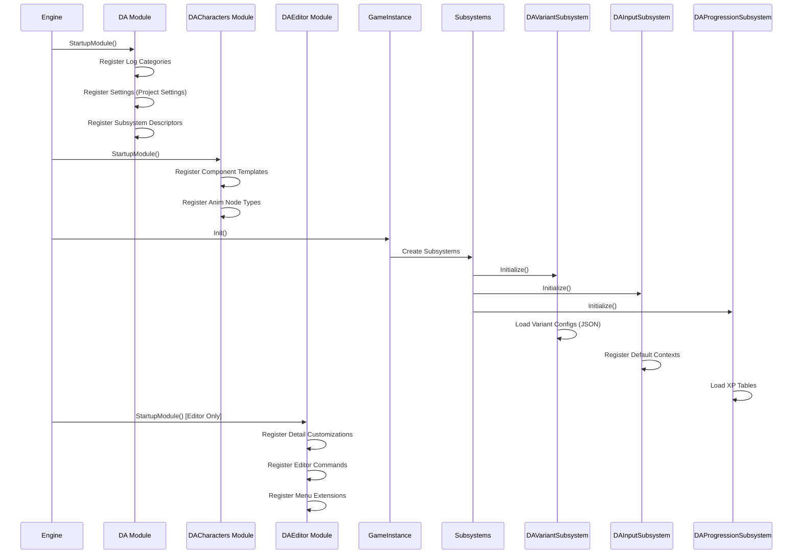

# 🔧 Technical Design Document — Module Design

<div align="center">


[← Architecture](01-Architecture.md) | [Data Flow →](03-Data-Flow.md)

</div>

---

## 📦 Module Specifications

### DA Module (Core Runtime)

**Purpose**: Core gameplay systems, shared interfaces, GAS integration, variant management

**Location**: `Source/DA/`

**Public API**:

| Header | Key Exports |
|--------|-------------|
| `DA.h` | Module initialization, logging |
| `DAAttributeSet.h` | `UDAAttributeSet` (Health, Stamina, Focus, Adrenaline) |
| `DACombatInterface.h` | `IDACombatInterface` (TakeDamage, OnHit, OnDeath) |
| `DAInputConfig.h` | `UDAInputConfig` (Data asset for input actions) |
| `DAVariantSubsystem.h` | `UDAVariantSubsystem` (Variant config, switching) |
| `DAProgressionSubsystem.h` | `UDAProgressionSubsystem` (XP, Level, Talents) |
| `DAGameMode.h` | `ADAGameModeBase` (Variant-aware GameMode) |
| `DAPlayerController.h` | `ADAPlayerController` (Input, Camera, Variant) |

**Private Implementation**:

| File | Responsibility |
|------|----------------|
| `DA.cpp` | Module startup/shutdown, command registration |
| `DAAttributeSet.cpp` | Attribute registration, replication, callbacks |
| `DAInputConfig.cpp` | Input action mapping, config loading |
| `DAVariantSubsystem.cpp` | JSON config parsing, variant application |
| `DAProgressionSubsystem.cpp` | XP curves, talent trees, save/load |
| `DAGameMode.cpp` | Variant setup, player spawn handling |
| `DAPlayerController.cpp` | Input binding, camera management |

**Build Configuration** (`DA.Build.cs`):

```csharp
PublicDependencyModuleNames.AddRange(new string[] {
    "Core", "CoreUObject", "Engine", "InputCore",
    "EnhancedInput", "GameplayAbilities", "GameplayTags",
    "GameplayTasks", "StateTree", "GameplayStateTree",
    "AIModule", "NavigationSystem", "Niagara",
    "DeveloperSettings", "Json", "JsonUtilities"
});

PrivateDependencyModuleNames.AddRange(new string[] {
    "Slate", "SlateCore", "UMG", "HTTP"
});
```

---

### DACharacters Module (Character System)

**Purpose**: Character implementation, movement, camera, animation, combat components

**Location**: `Source/DACharacters/`

**Public API**:

| Header | Key Exports |
|--------|-------------|
| `DACharacters.h` | Module header |
| `DACharacterBase.h` | `ADACharacterBase` (Base character, jump, damage) |
| `DAPlayerCharacter.h` | `ADAPlayerCharacter` (Player-specific: input, camera, abilities) |
| `DACharacterMovementComponent.h` | `UDACharacterMovementComponent` (Extended movement) |
| `DACameraComponent.h` | `UDACameraComponent` (Dual camera, blend, variant config) |
| `DAAnimInstance.h` | `UDAAnimInstance` (Layered anim, IK, notifies) |

**Private Implementation**:

| File | Responsibility |
|------|----------------|
| `DACharacters.cpp` | Module init |
| `DACharacterBase.cpp` | Base character logic, damage, death |
| `DAPlayerCharacter.cpp` | Enhanced Input, movement, camera toggle, ability binding |
| `DACharacterMovementComponent.cpp` | Variant-tuned movement, dash, wall run, platforming |
| `DACameraComponent.cpp` | Spring arm, FOV, collision, blend, photo mode |
| `DAAnimInstance.cpp` | State machine, layers, IK, gameplay notifies |

**Build Configuration** (`DACharacters.Build.cs`):

```csharp
PublicDependencyModuleNames.AddRange(new string[] {
    "Core", "CoreUObject", "Engine", "InputCore",
    "EnhancedInput", "GameplayAbilities", "GameplayTags",
    "GameplayTasks", "StateTree", "GameplayStateTree",
    "DA"  // Depends on DA module
});

PrivateDependencyModuleNames.AddRange(new string[] {
    "AnimGraphRuntime", "AnimationCore", "PhysicsCore"
});
```

---

### DAEditor Module (Editor Tools)

**Purpose**: Editor-only tools for variant config, input visualization, StateTree debugging

**Location**: `Source/DAEditor/`

**Public API**:

| Header | Key Exports |
|--------|-------------|
| `DAEditor.h` | Module header |
| `VariantConfigEditor.h` | `FVariantConfigEditor` (Details customization) |
| `InputMappingVisualizer.h` | `FInputMappingVisualizer` (Editor utility widget) |
| `StateTreeDebugger.h` | `FStateTreeDebugger` (Runtime visualization) |

**Private Implementation**:

| File | Responsibility |
|------|----------------|
| `DAEditor.cpp` | Module init, editor commands, menu registration |
| `VariantConfigEditor.cpp` | Property customization, validation, JSON export |
| `InputMappingVisualizer.cpp` | Graph view of input mappings, conflict detection |
| `StateTreeDebugger.cpp` | Real-time state visualization, transition logging |

**Build Configuration** (`DAEditor.Build.cs`):

```csharp
PublicDependencyModuleNames.AddRange(new string[] {
    "Core", "CoreUObject", "Engine", "InputCore",
    "UnrealEd", "EditorStyle", "PropertyEditor",
    "StateTreeEditor", "GameplayStateTreeEditor",
    "DA", "DACharacters"
});

PrivateDependencyModuleNames.AddRange(new string[] {
    "Slate", "SlateCore", "ToolMenus", "GraphEditor"
});

// Editor-only
Type = ModuleType.Editor;
```

---

## 🔗 Module Communication

### DA → DACharacters (Public Interface)

```cpp
// In DA module - Interface for character capabilities
class IDACharacterInterface
{
public:
    virtual UDAAttributeSet* GetAttributeSet() = 0;
    virtual UAbilitySystemComponent* GetAbilitySystem() = 0;
    virtual UStateTreeComponent* GetStateTree() = 0;
    virtual void ApplyVariantConfig(const FDAVariantConfig& Config) = 0;
};

// DACharacters implements this
class ADACharacterBase : public ACharacter, public IDACharacterInterface
{
    // ... implementation
};
```

### DACharacters → DA (Subsystem Access)

```cpp
// In DAPlayerCharacter.cpp
void ADAPlayerCharacter::BeginPlay()
{
    Super::BeginPlay();
    
    // Get variant subsystem from GameInstance
    if (UDAVariantSubsystem* VariantSub = GetWorld()->GetGameInstance()->GetSubsystem<UDAVariantSubsystem>())
    {
        VariantSub->OnVariantChanged.AddDynamic(this, &ADAPlayerCharacter::OnVariantChanged);
    }
    
    // Get progression subsystem
    if (UDAProgressionSubsystem* ProgSub = GetWorld()->GetGameInstance()->GetSubsystem<UDAProgressionSubsystem>())
    {
        ProgSub->OnLevelUp.AddDynamic(this, &ADAPlayerCharacter::OnLevelUp);
    }
}
```

### Editor → Runtime (Editor Module)

```cpp
// In DAEditor - Only compiles in Editor builds
#if WITH_EDITOR
void FVariantConfigEditor::OnPropertyChanged(const FPropertyChangedEvent& Event)
{
    // Validate variant config in real-time
    if (FDAVariantConfig* Config = GetConfig())
    {
        TArray<FText> Errors;
        if (!ValidateConfig(*Config, Errors))
        {
            ShowValidationErrors(Errors);
        }
    }
}
#endif
```

---

## 🎮 Variant Module Pattern

Each variant follows a consistent structure:

```
Content/Variant_<Name>/
├── Blueprints/
│   ├── BP_<Name>Character.uasset       # ADAPlayerCharacter child
│   ├── BP_<Name>GameMode.uasset        # ADAVariantGameMode child
│   ├── BP_<Name>PlayerController.uasset # ADAPlayerController child
│   └── BP_<Name>HUD.uasset             # HUD for variant
├── Input/
│   ├── IMC_<Name>.uasset               # Input Mapping Context
│   └── IA_<Name>_*.uasset              # Variant-specific Input Actions
├── StateTree/
│   ├── ST_<Name>.uasset                # Main StateTree
│   ├── ST_<Name>_Combat.uasset         # Combat subtree
│   ├── ST_<Name>_Movement.uasset       # Movement subtree
│   └── Tasks/Evaluators/               # Custom C++ tasks/evaluators
├── Anims/
│   ├── ABP_<Name>.uasset               # Animation Blueprint
│   ├── Montages/                       # Attack, Ability, Movement
│   └── Notifies/                       # AnimNotifies for gameplay
├── VFX/
│   └── NS_<Name>_*.uasset              # Niagara systems
├── Audio/
│   └── *.uasset                        # Sound cues, mixes
├── Levels/
│   └── Lvl_<Name>.umap                 # Main level
├── UI/
│   └── WBP_<Name>HUD.uasset            # HUD Widget
└── Config/
    └── Variant_<Name>.json             # Runtime config (loaded by subsystem)
```

---

## 🔧 Module Initialization Order



---

## 🧪 Module Testing

### Unit Test Structure

```
Source/DA/Tests/
├── DAAttributeSetTest.cpp        # Attribute registration, replication
├── DAVariantConfigTest.cpp       # JSON parsing, validation
├── DAProgressionTest.cpp         # XP curves, talent unlocks
└── DAInputConfigTest.cpp         # Action mapping, remapping

Source/DACharacters/Tests/
├── DACharacterBaseTest.cpp       # Jump, damage, death
├── DAPlayerCharacterTest.cpp     # Input binding, camera, abilities
├── DAMovementComponentTest.cpp   # Movement params, dash, wall run
├── DACameraComponentTest.cpp     # Blend, collision, FOV
└── DAAnimInstanceTest.cpp        # State machine, notifies, IK
```

### Test Execution

```bash
# Run all DA tests
UnrealEditor-Cmd.exe DA.uproject -run=AutomationTest -TestNames="DA.*" -nullrhi -nosound -unattended

# Run specific test
UnrealEditor-Cmd.exe DA.uproject -run=AutomationTest -TestNames="DA.AttributeSet" -nullrhi -nosound -unattended

# With reporting
UnrealEditor-Cmd.exe DA.uproject -run=AutomationTest -TestNames="DA.*" -outputdir=TestResults -format=XML -nullrhi -nosound -unattended
```

---

## 📊 Module Metrics

| Module | Lines (Est.) | Classes | Public Headers | Dependencies | Compile Time |
|--------|--------------|---------|----------------|--------------|--------------|
| **DA** | ~3,000 | 12 | 8 | 10 | ~30s |
| **DACharacters** | ~5,000 | 15 | 6 | 8 (+DA) | ~45s |
| **DAEditor** | ~2,000 | 8 | 4 | 12 (+DA+DAChars) | ~20s |

---

## 🔗 Related Documents

| Document | Link |
|----------|------|
| **TDD Overview** | [00-Overview.md](00-Overview.md) |
| **Architecture** | [01-Architecture.md](01-Architecture.md) |
| **Data Flow** | [03-Data-Flow.md](03-Data-Flow.md) |
| **Networking** | [04-Networking.md](04-Networking.md) |
| **Performance** | [05-Performance.md](05-Performance.md) |
| **GDD Character Design** | [../GDD/03-Character-Design.md](../GDD/03-Character-Design.md) |

---

> **Module Boundaries**: DA = Systems/Interfaces. DACharacters = Implementation/Components. DAEditor = Tools only. No circular dependencies. All cross-module via interfaces or subsystems.