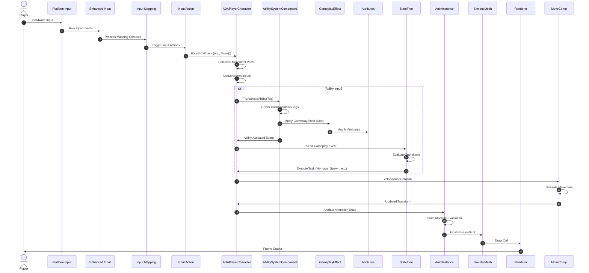
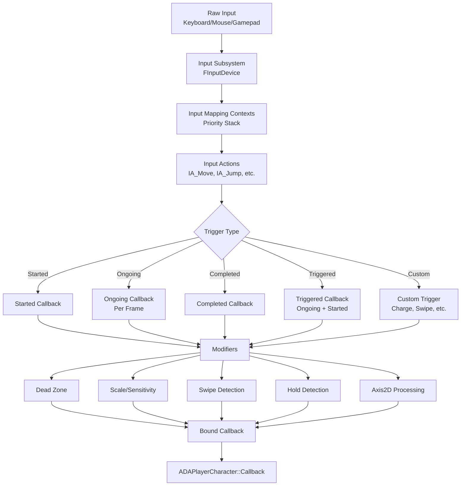
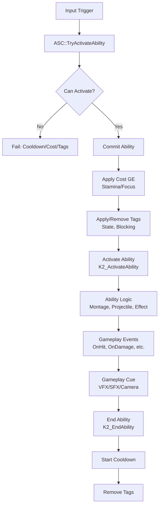
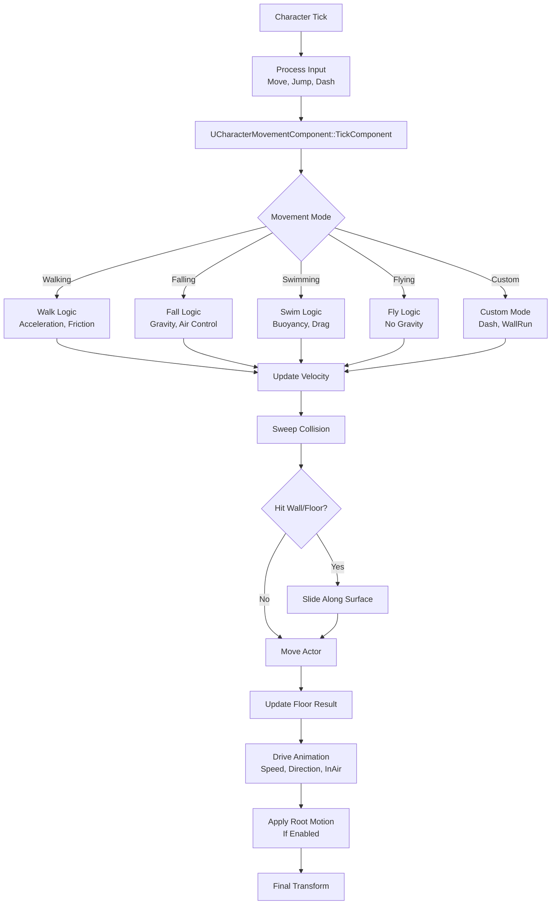
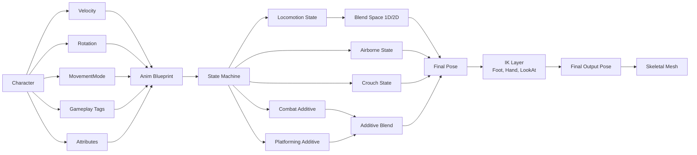
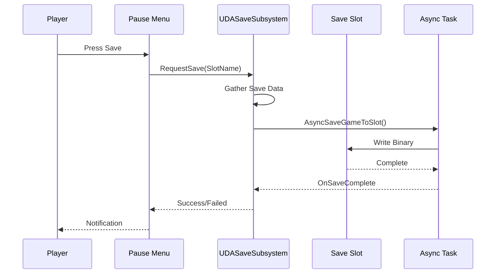

# 🔧 Technical Design Document — Data Flow

<div align="center">


[← Module Design](02-Module-Design.md) | [Networking →](04-Networking.md)

</div>

---

## 🔄 End-to-End Data Flow

### Input → Gameplay → Render Pipeline



---

## 📥 Input Pipeline

### Enhanced Input Flow



### Input Action Data Flow

```cpp
// IA_Move (Axis2D) → Move()
void ADAPlayerCharacter::Move(const FInputActionValue& Value)
{
    // 1. Extract 2D vector
    FVector2D MovementVector = Value.Get<FVector2D>();  // X=Strafe, Y=Forward
    
    // 2. Validate controller
    if (!Controller) return;
    
    // 3. Calculate yaw-relative directions
    const FRotator Rotation = Controller->GetControlRotation();
    const FRotator YawRotation(0, Rotation.Yaw, 0);
    const FVector ForwardDirection = FRotationMatrix(YawRotation).GetUnitAxis(EAxis::X);
    const FVector RightDirection = FRotationMatrix(YawRotation).GetUnitAxis(EAxis::Y);
    
    // 4. Apply movement input (Y=Forward, X=Right)
    AddMovementInput(ForwardDirection, MovementVector.Y);
    AddMovementInput(RightDirection, MovementVector.X);
}
```

---

## ⚔️ Combat Ability Pipeline

### Gameplay Ability Activation



### Damage Calculation Flow

```mermaid
flowchart TD
    Attack[Attack Hits] --> Context[Build FDamageContext]
    Context --> Base[Base Damage\nWeapon + Stats]
    Base --> AttackerMod[Attacker Modifiers\nBuffs, Stance, Combo]
    AttackerMod --> DefenderMod[Defender Modifiers\nArmor, Resistance, Debuffs]
    DefenderMod --> TypeEff[Type Effectiveness\nPhysical vs Armor]
    TypeEff --> Crit{Critical Hit?}
    Crit -->|Yes| CritMult[×1.5 + Crit Damage]
    Crit -->|No| NoCrit[×1.0]
    CritMult --> Variance[±5% Variance]
    NoCrit --> Variance
    Variance --> Min[Max(1, Damage)]
    Min --> Apply[Apply Damage GE]
    Apply --> Health[Modify Health Attribute]
    Health --> Death{Health ≤ 0?}
    Death -->|Yes| Die[OnDeath Event]
    Death -->|No| React[Hit Reaction]
    React --> Cue[Damage Cue\nNumbers, VFX, SFX]
```

---

## 🏃 Movement Pipeline

### Character Movement Tick



### Variant Movement Parameters

| Parameter | TP | Combat | Platforming | SideScroll |
|-----------|-----|--------|-------------|------------|
| **MaxWalkSpeed** | 600 | 500 | 600 | 400 |
| **MaxSprintSpeed** | 1200 | 900 | 1300 | N/A |
| **Acceleration** | 2000 | 2500 | 3000 | 3000 |
| **Deceleration** | 2000 | 3000 | 5000 | 5000 |
| **JumpZVelocity** | 700 | 650 | 800 | 750 |
| **AirControl** | 0.35 | 0.30 | 0.50 | 0.40 |
| **DashDistance** | 500 | 500 | 400 | 300 |
| **DashCooldown** | 1.0s | 1.0s | 0.8s | 0.6s |
| **WallRunSpeed** | 800 | 700 | 800 | N/A |
| **LedgeGrabHeight** | 200 | 150 | 250 | N/A |

---

## 🎭 Animation Pipeline

### Animation Blueprint Data Flow



### Gameplay Tag → Animation Mapping

| Gameplay Tag | Animation Effect |
|--------------|------------------|
| `State.Moving` | Enable Locomotion blend |
| `State.Sprinting` | Sprint blend space |
| `State.InAir` | Airborne state |
| `State.Crouching` | Crouch state |
| `Ability.Attack` | Attack montage (slot) |
| `Ability.Dodge` | Dodge montage (slot) |
| `State.Stunned` | Stun additive (full body) |
| `State.Dead` | Death montage |

---

## 💾 Data Persistence

### Save Game Structure

```cpp
// DASaveGame.h
UCLASS()
class UDASaveGame : public USaveGame
{
    GENERATED_BODY()

public:
    // Player Identity
    FString PlayerName;
    FGuid PlayerId;
    int32 SaveVersion = 1;
    FDateTime SaveTime;

    // Progression
    int32 Level = 1;
    float CurrentXP = 0;
    float TotalXP = 0;
    TArray<FName> UnlockedTalents;
    TMap<FName, int32> TalentRanks;

    // Variant Progress (Per Variant)
    struct FVariantSaveData
    {
        FName VariantName;
        int32 VariantLevel = 1;
        float VariantXP = 0;
        TArray<FName> UnlockedAbilities;
        TMap<FName, int32> AbilityRanks;
        FTransform LastCheckpoint;
        TArray<FName> CompletedObjectives;
    };
    TMap<FName, FVariantSaveData> VariantData;

    // Inventory
    struct FItemSaveData
    {
        FName ItemId;
        int32 Quantity = 1;
        int32 Level = 1;
        TMap<FName, float> Stats;
    };
    TArray<FItemSaveData> Inventory;
    TArray<FItemSaveData> EquippedItems;

    // World State
    FName CurrentLevel;
    FTransform PlayerTransform;
    TArray<FName> WorldStates;  // Doors opened, bosses killed, etc.
    TMap<FName, float> WorldFloats;  // Puzzle states, etc.
};
```

### Save/Load Flow



---

## 📊 Data Tables & Curves

### XP Curve (Data Table)

| Level | XP Required | Total XP | Talent Points |
|-------|-------------|----------|---------------|
| 1 | 0 | 0 | 0 |
| 2 | 1000 | 1000 | 1 |
| 3 | 2500 | 3500 | 1 |
| 4 | 5000 | 8500 | 1 |
| 5 | 9000 | 17500 | 2 |
| 10 | 50000 | ~200k | 10 |
| 20 | 200000 | ~1.5M | 20 |
| 30 | 500000 | ~4M | 30 |
| 40 | 1000000 | ~9M | 40 |
| 50 | 2000000 | ~20M | 50 |

### Talent Tree Data (JSON)

```json
{
  "TalentTree_ThirdPerson": {
    "Name": "Wayfarer's Path",
    "Categories": [
      {
        "Name": "Exploration",
        "Icon": "UI_Icons.Exploration",
        "Talents": [
          {
            "Id": "Talent_SprintMastery",
            "Name": "Sprint Mastery",
            "Description": "Increase sprint speed by 10% per rank.",
            "MaxRank": 3,
            "Cost": [1, 1, 2],
            "Effect": { "Type": "MoveSpeed", "Op": "Multiply", "Value": [1.05, 1.1, 1.15] },
            "Position": { "X": 0, "Y": 0 },
            "Connections": ["Talent_EndlessStamina"]
          }
        ]
      }
    ]
  }
}
```

---

## 🔗 Related Documents

| Document | Link |
|----------|------|
| **TDD Overview** | [00-Overview.md](00-Overview.md) |
| **Architecture** | [01-Architecture.md](01-Architecture.md) |
| **Module Design** | [02-Module-Design.md](02-Module-Design.md) |
| **Networking** | [04-Networking.md](04-Networking.md) |
| **Performance** | [05-Performance.md](05-Performance.md) |
| **GDD Core Gameplay Loop** | [../GDD/01-Core-Gameplay-Loop.md](../GDD/01-Core-Gameplay-Loop.md) |
| **GDD Combat Systems** | [../GDD/04-Combat-Systems.md](../GDD/04-Combat-Systems.md) |

---

> **Data Ownership**: Input → Character → AbilitySystem → Attributes → StateTree → Animation → Render. Each system owns its data; cross-system via events/tags. No direct attribute mutation outside GAS.