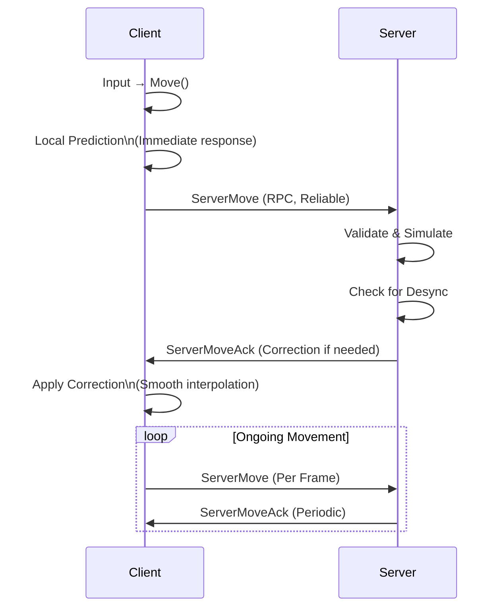
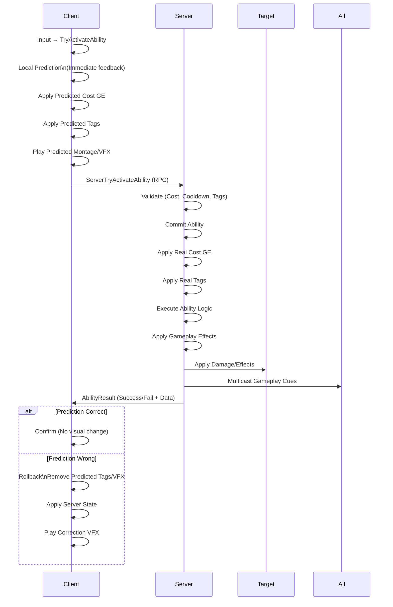

# 🔧 Technical Design Document — Networking

<div align="center">


[← Data Flow](03-Data-Flow.md) | [Performance →](05-Performance.md)

</div>

---

## 🌐 Networking Architecture

### Target Model: Client-Server with Prediction

```
Network Topology
├── Dedicated Server (Authoritative)
│   ├── GameMode (Server Only)
│   ├── GameState (Replicated)
│   ├── AI Controllers (Server Only)
│   ├── Physics Simulation (Server)
│   └── Ability Execution (Server)
├── Client 1 (Player 1)
│   ├── PlayerController (Autonomous Proxy)
│   ├── Character (Autonomous Proxy)
│   ├── Predicted Movement
│   ├── Predicted Abilities
│   └── Local Cosmetics (VFX/SFX)
├── Client 2 (Player 2)
│   └── ...
└── Client N (Player N)
    └── ...
```

### Replication Strategy

| Actor/Component | Replication | Owner | Update Rate |
|-----------------|-------------|-------|-------------|
| **GameMode** | None (Server Only) | Server | N/A |
| **GameState** | Full | Server | 10 Hz |
| **PlayerController** | Owner Only | Owning Client | Event |
| **Character (Self)** | Autonomous Proxy | Owning Client | 60 Hz (Movement) |
| **Character (Others)** | Simulated Proxy | Server | 20-30 Hz |
| **AbilitySystemComponent** | Owner + Relevant | Owner/Server | Event |
| **Attributes** | Owner + Relevant | Server | On Change |
| **Gameplay Effects** | Owner + Relevant | Server | On Apply |
| **StateTree** | Server Only | Server | N/A (Client predicts) |
| **Animation** | None (Client-side) | Client | Local |
| **Cosmetic VFX/SFX** | Multicast (Non-reliable) | Server/Client | Event |

---

## 🏃 Movement Networking

### Character Movement Replication



### Movement Component Settings

```cpp
// DACharacterMovementComponent.h
UCLASS()
class DACHARACTERS_API UDACharacterMovementComponent : public UCharacterMovementComponent
{
    GENERATED_BODY()

public:
    // Network smoothing
    UPROPERTY(EditAnywhere, Category = "Network")
    float NetSmoothingTime = 0.1f;
    
    UPROPERTY(EditAnywhere, Category = "Network")
    float NetSmoothingDistanceThreshold = 50.0f;
    
    UPROPERTY(EditAnywhere, Category = "Network")
    float NetSmoothingRotationThreshold = 5.0f;
    
    // Prediction
    UPROPERTY(EditAnywhere, Category = "Network")
    bool bEnablePrediction = true;
    
    UPROPERTY(EditAnywhere, Category = "Network")
    int32 MaxPredictionFrames = 3;
    
    // Correction
    UPROPERTY(EditAnywhere, Category = "Network")
    float CorrectionInterpSpeed = 20.0f;
    
    UPROPERTY(EditAnywhere, Category = "Network")
    float LargeCorrectionThreshold = 500.0f;
    
    // Custom movement sync
    virtual void ServerMove_Implementation(FVector_NetQuantize10 Location, 
                                           FVector_NetQuantize10 Velocity, 
                                           uint8 CompressedRotation, 
                                           float Timestamp) override;
    
    virtual void ClientAdjustPosition_Implementation(float Timestamp, 
                                                      FVector NewLoc, 
                                                      FVector NewVel, 
                                                      UPrimitiveComponent* NewBase, 
                                                      FName NewBaseBone, 
                                                      bool bHasBase, 
                                                      bool bBaseRelativePosition, 
                                                      uint8 ServerMovementMode) override;
};
```

### Input Buffering for Prediction

```cpp
// Client-side input buffer
struct FPendingMove
{
    uint32 FrameNumber;
    FVector WorldDirection;
    float DeltaTime;
    FVector Velocity;
    FVector Location;
    uint8 MovementMode;
    bool bJump;
    bool bDash;
    FVector DashDirection;
};

class ADAPlayerCharacter : public ADACharacterBase
{
    // Input buffer for re-simulation after correction
    TArray<FPendingMove> PendingMoves;
    const int32 MaxPendingMoves = 128; // ~2 seconds at 60 FPS
    
    void AddPendingMove(const FPendingMove& Move);
    void AcknowledgeMove(uint32 ServerFrame);
    void ResimulateFrom(uint32 Frame);
};
```

---

## ⚔️ Ability System Networking

### GAS Replication Model

```mermaid
graph TB
    subgraph "Server (Authoritative)"
        ASC_S[ASC Server]
        ASC_S --> GE_S[Gameplay Effects\nInstant/Duration/Infinite]
        ASC_S --> Attr_S[Attributes\nHealth, Resources]
        ASC_S --> Tags_S[Gameplay Tags\nState, Buffs]
        ASC_S --> Abil_S[Abilities\nActivation/Execution]
        ASC_S --> Cues_S[Gameplay Cues\nNotify/Exec/Loop]
    end
    
    subgraph "Client (Autonomous)"
        ASC_C[ASC Client]
        ASC_C --> Pred[Prediction\nLocal Activation]
        ASC_C --> Attr_C[Attributes\nLocal Shadow]
        ASC_C --> Tags_C[Tags\nPredicted]
        ASC_C --> Abil_C[Abilities\nPredicted Activation]
        ASC_C --> Cues_C[Gameplay Cues\nLocal Instant]
    end
    
    subgraph "Replication"
        GE_S -.->|Replicate| GE_C[Client GE\n(Simulated Proxy)]
        Attr_S -.->|Replicate| Attr_C
        Tags_S -.->|Replicate| Tags_C
        Cues_S -.->|Multicast| Cues_All[All Clients]
    end
```

### Ability Activation Flow (Networked)



### Gameplay Effect Replication

| Effect Type | Replication | Notes |
|-------------|-------------|-------|
| **Instant** | Server Only | No client prediction needed |
| **Duration** | Server → Client | Client simulates duration locally |
| **Infinite** | Server → Client | Client maintains until removed |
| **Periodic** | Server → Client | Client ticks period locally |
| **Execution** | Server Only | Custom calculation on server |

---

## 🧠 AI & StateTree Networking

### Server-Authoritative AI

```mermaid
flowchart TD
    Server[Server] --> ST[StateTree Component]
    ST --> Eval[Evaluate Transitions]
    Eval --> Task[Execute Tasks]
    Task --> Move[MoveTo Task]
    Task --> Ability[Ability Task]
    Task --> Spawn[Spawn Actor]
    Task --> Event[Send Gameplay Event]
    
    Move --> Nav[Navigation System]
    Nav --> Path[Path Following]
    Path --> MoveComp[AI MoveComp]
    MoveComp --> Replicate[Replicate Transform]
    
    Ability --> ASC[AbilitySystemComponent]
    ASC --> GE[Apply GE]
    GE --> Replicate[Replicate to Clients]
    
    Event --> Clients[Multicast to Clients]
    Clients --> ClientST[Client StateTree\n(If Needed)]
```

### AI Replication Settings

```cpp
// AI Controller
class ADAAIController : public AAIController
{
    // Only replicate essential state
    virtual void GetLifetimeReplicatedProps(TArray<FLifetimeProperty>& OutLifetimeProps) const override
    {
        Super::GetLifetimeReplicatedProps(OutLifetimeProps);
        DOREPLIFETIME(ADAAIController, CurrentState);
        DOREPLIFETIME(ADAAIController, TargetActor);
        DOREPLIFETIME(ADAAIController, PatrolIndex);
    }
    
    UPROPERTY(ReplicatedUsing=OnRep_CurrentState)
    FName CurrentState;
    
    UPROPERTY(Replicated)
    AActor* TargetActor;
    
    // StateTree runs on server only
    UPROPERTY(VisibleAnywhere, Category = "AI")
    TObjectPtr<UStateTreeComponent> StateTree;
};
```

---

## 🎮 Player Controller Networking

### Ownership & Authority

```cpp
// DAPlayerController.h
UCLASS()
class DA_API ADAPlayerController : public APlayerController
{
    GENERATED_BODY()

public:
    // RPC: Client → Server (Input)
    UFUNCTION(Server, Reliable, WithValidation)
    void ServerRequestAbility(FGameplayTag AbilityTag, const FVector_NetQuantize& TargetLocation);
    
    UFUNCTION(Server, Reliable, WithValidation)
    void ServerRequestVariantSwitch(FName NewVariant);
    
    // RPC: Server → Client (Cosmetic/State)
    UFUNCTION(Client, Reliable)
    void ClientAbilityResult(FGameplayTag AbilityTag, bool bSuccess, float CooldownRemaining);
    
    UFUNCTION(Client, Reliable)
    void ClientVariantApplied(FName VariantName, bool bSuccess);
    
    // Multicast: Server → All (Cosmetic)
    UFUNCTION(NetMulticast, Unreliable)
    void MulticastPlayMontage(UAnimMontage* Montage, float PlayRate);
    
    UFUNCTION(NetMulticast, Unreliable)
    void MulticastGameplayCue(FGameplayTag CueTag, FVector Location, FRotator Rotation);
};
```

---

## 📦 Bandwidth Optimization

### Net Update Frequencies

| Actor Type | NetUpdateFrequency | MinNetUpdateFrequency | Priority |
|------------|-------------------|----------------------|----------|
| **Local Character** | 60 | 30 | 3.0 |
| **Remote Character** | 30 | 10 | 1.5 |
| **Projectiles** | 30 | 10 | 2.0 |
| **Pickups** | 2 | 1 | 0.5 |
| **Environmental** | 1 | 0.5 | 0.2 |

### Property Replication Conditions

```cpp
// In Character
DOREPLIFETIME_CONDITION(ADAPlayerCharacter, Health, COND_OwnerOnly);
DOREPLIFETIME_CONDITION(ADAPlayerCharacter, Stamina, COND_OwnerOnly);
DOREPLIFETIME_CONDITION(ADAPlayerCharacter, Focus, COND_OwnerOnly);
DOREPLIFETIME_CONDITION(ADAPlayerCharacter, CurrentWeapon, COND_OwnerOnly);

// In AttributeSet
DOREPLIFETIME_CONDITION(UDAAttributeSet, Health, COND_OwnerOnly);
DOREPLIFETIME_CONDITION(UDAAttributeSet, MaxHealth, COND_OwnerOnly);
DOREPLIFETIME_CONDITION(UDAAttributeSet, Stamina, COND_OwnerOnly);
// Public attributes replicate to all
DOREPLIFETIME(UDAAttributeSet, MoveSpeed);
DOREPLIFETIME(UDAAttributeSet, DamageMult);
```

### Bit Packing for Custom RPCs

```cpp
// Packed movement input (saves bandwidth)
struct FNetPackedMove
{
    uint8 InputFlags;      // Bit 0: Forward, 1: Back, 2: Left, 3: Right, 4: Jump, 5: Dash, 6: Crouch, 7: Sprint
    int16 YawCompressed;   // Compressed rotation (0-65535 = 0-360°)
    int16 PitchCompressed; // Compressed pitch
    uint8 MovementMode;    // Enum
};

// Instead of replicating full vectors
UFUNCTION(Server, Reliable)
void ServerMovePacked(FNetPackedMove PackedMove, float Timestamp);
```

---

## 🛡 Anti-Cheat & Validation

### Server-Side Validation

```cpp
// Server validation for movement
bool ADAPlayerCharacter::ValidateServerMove(const FVector& ClientLocation, 
                                             const FVector& ClientVelocity, 
                                             float Timestamp)
{
    // Time check
    if (!IsTimestampValid(Timestamp)) return false;
    
    // Distance check
    float DistSq = (GetActorLocation() - ClientLocation).SizeSquared();
    if (DistSq > MaxCorrectionDistanceSq) return false;
    
    // Speed check
    if (ClientVelocity.SizeSquared() > MaxAllowedSpeedSq) return false;
    
    // Collision check (re-simulate)
    if (!ServerSimulateMove(ClientLocation, ClientVelocity)) return false;
    
    return true;
}

// Ability validation
bool ADAPlayerController::ServerRequestAbility_Validate(FGameplayTag AbilityTag, 
                                                         const FVector_NetQuantize& TargetLocation)
{
    // Check ability exists
    if (!AbilityTag.IsValid()) return false;
    
    // Check ownership
    if (!GetPawn<ADAPlayerCharacter>()) return false;
    
    // Check cooldown (server authoritative)
    if (ASC->GetCooldownRemaining(AbilityTag) > 0) return false;
    
    // Check cost
    if (!ASC->CanActivateAbility(AbilityTag)) return false;
    
    return true;
}
```

---

## 🔗 Related Documents

| Document | Link |
|----------|------|
| **TDD Overview** | [00-Overview.md](00-Overview.md) |
| **Architecture** | [01-Architecture.md](01-Architecture.md) |
| **Module Design** | [02-Module-Design.md](02-Module-Design.md) |
| **Data Flow** | [03-Data-Flow.md](03-Data-Flow.md) |
| **Performance** | [05-Performance.md](05-Performance.md) |
| **GDD Variant Designs** | [../GDD/02-Variant-Designs.md](../GDD/02-Variant-Designs.md) |

---

> **Status**: Networking is planned for v0.4. Current codebase is single-player/local multiplayer ready. All components designed with replication in mind (ReplicatedUsing, RPCs, GameplayEffect replication).