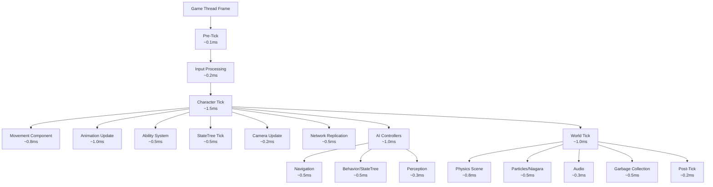
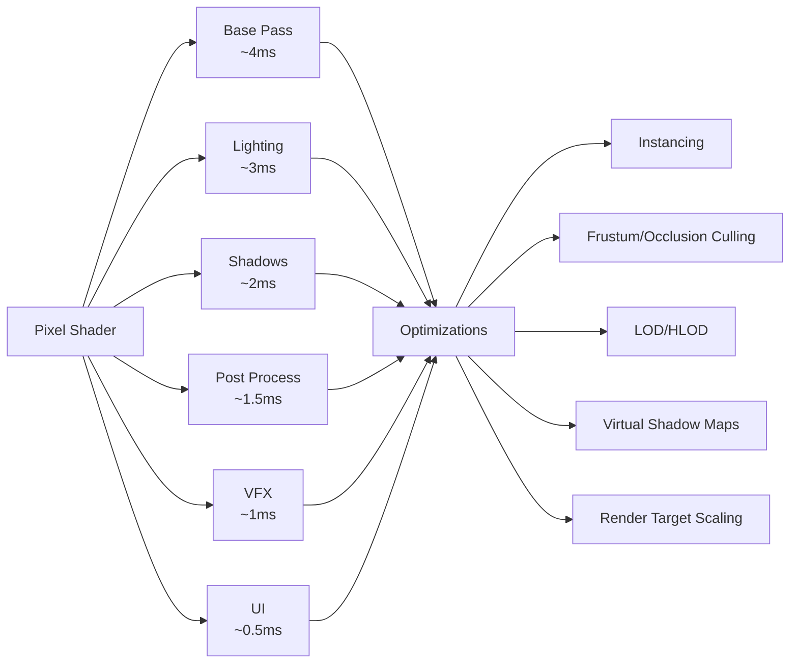

# 🔧 Technical Design Document — Performance

<div align="center">


[← Networking](04-Networking.md) | [Back to TDD Overview](00-Overview.md)

</div>

---

## 🎯 Performance Targets

### Frame Budget (60 FPS = 16.67ms)

| Thread | Budget | Target | Critical Path |
|--------|--------|--------|---------------|
| **Game Thread** | 8.0ms | < 6.0ms | Gameplay, AI, Ability, Input |
| **Render Thread** | 8.0ms | < 6.0ms | Draw Calls, Shadows, Post-Process |
| **GPU** | 16.67ms | < 12.0ms | Vertex, Pixel, Compute |
| **RHI** | 1.0ms | < 0.5ms | Command Buffer, Resource Updates |

### Memory Budgets

| Pool | Budget | Target | Notes |
|------|--------|--------|-------|
| **System RAM** | 8 GB | < 6 GB | Includes OS |
| **Video RAM** | 6 GB | < 4 GB | Textures, Meshes, RTs |
| **Texture Streaming** | 2 GB | < 1.5 GB | Priority-based |
| **Static Meshes** | 500 MB | < 300 MB | Nanite where possible |
| **Skeletal Meshes** | 200 MB | < 150 MB | LODs critical |
| **Animations** | 300 MB | < 200 MB | Compression, streaming |
| **Audio** | 200 MB | < 150 MB | Streaming, compression |
| **Gameplay** | 500 MB | < 300 MB | Objects, AI, Effects |

---

## 🎮 Game Thread Optimization

### Tick Architecture



### Optimization Strategies

#### 1. Tick Pruning

```cpp
// Only tick what's needed
ADAPlayerCharacter::ADAPlayerCharacter()
{
    // Disable tick if not needed
    PrimaryActorTick.bCanEverTick = true;
    PrimaryActorTick.TickInterval = 0.0f; // Every frame
    
    // But components can be more selective
    GetCharacterMovement()->SetComponentTickEnabled(true);
    GetMesh()->SetComponentTickEnabled(true); // Anim needs tick
    
    // Disable on dedicated server for non-local
    if (HasAuthority() && !IsLocallyControlled())
    {
        // Server doesn't need to tick camera
        CameraComponent->SetComponentTickEnabled(false);
    }
}

// Conditional tick for AI
void ADAAIController::Tick(float DeltaTime)
{
    Super::Tick(DeltaTime);
    
    // Reduce tick rate for distant AI
    float DistSq = (GetPawn()->GetActorLocation() - PlayerLocation).SizeSquared();
    if (DistSq > 25000000.0f) // 5000cm
    {
        // Skip heavy logic, just update position
        return;
    }
}
```

#### 2. Component Activation

```cpp
// Activate components only when needed
void ADAPlayerCharacter::OnVariantChanged(FName NewVariant)
{
    // Deactivate unused variant components
    CombatComponent->SetComponentTickEnabled(NewVariant == "Combat");
    PlatformingComponent->SetComponentTickEnabled(NewVariant == "Platforming");
    StealthComponent->SetComponentTickEnabled(NewVariant == "SideScrolling");
    
    // Movement mode changes
    GetCharacterMovement()->SetMovementMode(
        NewVariant == "SideScrolling" ? MOVE_Flying : MOVE_Walking
    );
}
```

#### 3. Async Operations

```cpp
// Offload heavy computation to async tasks
void ADAProgressionSubsystem::CalculateXPRewards()
{
    // Use AsyncTask for heavy math
    AsyncTask(ENamedThreads::AnyThread, [this]()
    {
        // Heavy calculation
        TArray<FXPReward> Rewards = ComputeRewards();
        
        // Back to game thread for application
        AsyncTask(ENamedThreads::GameThread, [this, Rewards]()
        {
            ApplyRewards(Rewards);
        });
    });
}
```

---

## 🎨 Render Thread Optimization

### Draw Call Budget

| Category | Target Draw Calls | Technique |
|----------|-------------------|-----------|
| **Characters** | < 50 | Instancing, Merged Meshes |
| **Environment** | < 200 | HLOD, Nanite, Imposters |
| **VFX** | < 100 | GPU Sim, Ribbon/Mesh |
| **UI** | < 20 | Atlas, Batching |
| **Shadows** | < 30 | CSM, Virtual Shadow Maps |
| **Total** | **< 400** | |

### Nanite & Virtual Geometry

```cpp
// Enable Nanite for static environment
// In Build.cs or Project Settings
bUseNanite = true;

// Static meshes: Enable Nanite in editor
// Skeletal meshes: Use traditional LODs

// Nanite settings for performance
[/Script/Engine.NaniteSettings]
r.Nanite.MaxPixelsPerEdge=2.0
r.Nanite.ProxyTrianglePercent=10
r.Nanite.Streaming.MaxResources=2048
```

### Material Optimization

```hlsl
// Shader permutation reduction
// Use Material Layers instead of switches

// Bad: Many permutations
#if USE_NORMAL_MAP
    Normal = SampleNormal();
#endif
#if USE_ROUGHNESS_MAP
    Roughness = SampleRoughness();
#endif

// Good: Material Layer Blend
// Base Layer + Normal Layer + Roughness Layer
// Single shader, runtime blend
```

### Texture Streaming

```ini
; Config/DefaultEngine.ini
[TextureStreaming]
r.Streaming.PoolSize=2048
r.Streaming.MaxTempMemoryAllowed=512
r.Streaming.MinTempMemoryAllowed=128
r.Streaming.MaxEffectiveScreenSize=0
r.Streaming.UseFixedPoolSize=1

; Per-platform overrides
[/Script/Engine.TextureLODSettings]
; Mobile: Lower budgets
; Console: Higher budgets
```

---

## 🎭 Animation Optimization

### Evaluation Budget

| Component | Budget | Technique |
|-----------|--------|-----------|
| **State Machine** | 0.3ms | Minimize transitions, use cached poses |
| **Blend Spaces** | 0.2ms | Reduce dimensions, cache samples |
| **Montages** | 0.1ms | Limit concurrent, use slots |
| **IK** | 0.3ms | Two-bone IK, limit bones |
| **Cloth/Physics** | 0.2ms | GPU simulation, distance fields |
| **Total** | **1.0ms** | |

### Animation Blueprint Optimization

```cpp
// In AnimGraph - Use cached poses
// Bad: Multiple state machines evaluating same logic
// Good: Single state machine with layered blend

// Layered approach:
// Base Layer: Locomotion (cached)
// Additive Layer 1: Combat (slot)
// Additive Layer 2: Platforming (slot)
// Additive Layer 3: Hit React (slot)
// Post Process: IK (minimal bones)

// Use "Save Cached Pose" / "Use Cached Pose" nodes
// Avoid re-evaluating same state machine multiple times
```

### Skeletal Mesh LODs

| LOD | Screen Size | Triangles | Bones | Use Case |
|-----|-------------|-----------|-------|----------|
| **LOD 0** | 100% | 15,000 | Full | Close-up, Cinematics |
| **LOD 1** | 50% | 8,000 | Full | Normal gameplay |
| **LOD 2** | 25% | 4,000 | No fingers | Medium distance |
| **LOD 3** | 12% | 2,000 | No fingers, no face | Far distance |
| **LOD 4** | 5% | 500 | Torso only | Very far, crowds |

---

## ⚡ GPU Optimization

### Shader Complexity



### Render Target Scaling

```cpp
// Dynamic resolution scaling
void ADAPlayerController::UpdateDynamicResolution()
{
    static float FrameTimeHistory[60] = {0};
    static int32 FrameIndex = 0;
    
    FrameTimeHistory[FrameIndex++] = GEngine->GetAverageFrameTime();
    FrameIndex %= 60;
    
    float AvgFrameTime = 0;
    for (int i = 0; i < 60; i++) AvgFrameTime += FrameTimeHistory[i];
    AvgFrameTime /= 60;
    
    // Target 16.67ms (60 FPS)
    if (AvgFrameTime > 18.0f) // Over budget
    {
        CurrentResolutionScale = FMath::Max(0.5f, CurrentResolutionScale - 0.05f);
    }
    else if (AvgFrameTime < 14.0f) // Headroom
    {
        CurrentResolutionScale = FMath::Min(1.0f, CurrentResolutionScale + 0.02f);
    }
    
    GEngine->SetGlobalResolutionScale(CurrentResolutionScale);
}
```

### Post-Process Budget

| Effect | Cost | Optimization |
|--------|------|--------------|
| **Bloom** | 0.3ms | Lower resolution, separable |
| **DOF** | 0.5ms | Bokeh only when needed |
| **Motion Blur** | 0.4ms | Tile-based, lower samples |
| **AA (TSR)** | 1.0ms | Native TSR, history reuse |
| **Color Grading** | 0.1ms | LUT texture |
| **Vignette/Grain** | 0.05ms | Simple math |
| **Total** | **~2.5ms** | |

---

## 🧠 AI Performance

### AI Tick Budget

| System | Budget | Optimization |
|--------|--------|--------------|
| **Perception** | 0.3ms | Team senses, async traces |
| **Navigation** | 0.5ms | Shared paths, hierarchical |
| **StateTree** | 0.5ms | Batch evaluation, caching |
| **Targeting** | 0.2ms | Spatial partitioning |
| **Total** | **1.5ms** | |

### Navigation Optimization

```cpp
// Navigation settings for performance
[/Script/NavigationSystem.NavSystemConfig]
bEnableNavOctree=true
NavOctreeTileSize=4096
TileSize=2048
CellSize=19.2
CellHeight=19.2
AgentRadius=42.0
AgentHeight=192.0
AgentMaxSlope=45.0
AgentMaxStepHeight=40.0

// Use NavMesh tiles for streaming
// Only rebuild dirty tiles
// Share paths between similar AI
```

### AI LOD System

```cpp
// AI LOD based on distance to player
void ADAAIController::UpdateAILOD()
{
    float DistSq = (GetPawn()->GetActorLocation() - PlayerLocation).SizeSquared();
    
    if (DistSq < 1000000.0f) // < 1000cm
    {
        // LOD 0: Full simulation
        SetTickInterval(0.016f); // 60 Hz
        PerceptionComponent->SetSensesUpdateInterval(0.1f);
        StateTree->SetEvaluationFrequency(ETickRate::Full);
    }
    else if (DistSq < 25000000.0f) // < 5000cm
    {
        // LOD 1: Reduced
        SetTickInterval(0.033f); // 30 Hz
        PerceptionComponent->SetSensesUpdateInterval(0.2f);
        StateTree->SetEvaluationFrequency(ETickRate::Half);
    }
    else
    {
        // LOD 2: Minimal
        SetTickInterval(0.1f); // 10 Hz
        PerceptionComponent->SetSensesUpdateInterval(0.5f);
        StateTree->SetEvaluationFrequency(ETickRate::Quarter);
        // Disable complex behaviors
        DisableComplexTasks();
    }
}
```

---

## 📊 Profiling & Monitoring

### Unreal Insights Markers

```cpp
// Custom profiling scopes
#define DA_SCOPE_CYCLE_COUNTER(Name) \
    SCOPE_CYCLE_COUNTER(STAT_DA_##Name)

#define DA_SCOPE_SECONDS_COUNTER(Name) \
    SCOPE_SECONDS_COUNTER(STAT_DA_##Name)

// Usage
void ADAPlayerCharacter::Move(const FInputActionValue& Value)
{
    DA_SCOPE_CYCLE_COUNTER(Move);
    // ... movement logic
}

void UDAAbilitySystemComponent::ApplyGameplayEffect()
{
    DA_SCOPE_CYCLE_COUNTER(ApplyGE);
    // ... GE logic
}
```

### Stats Groups

```cpp
// In DAModule.cpp
DECLARE_STATS_GROUP(TEXT("DA Framework"), STATGROUP_DA, STATCAT_Advanced);
DECLARE_CYCLE_STAT(TEXT("DA Move"), STAT_DA_Move, STATGROUP_DA);
DECLARE_CYCLE_STAT(TEXT("DA Ability Activate"), STAT_DA_AbilityActivate, STATGROUP_DA);
DECLARE_CYCLE_STAT(TEXT("DA StateTree Tick"), STAT_DA_StateTreeTick, STATGROUP_DA);
DECLARE_CYCLE_STAT(TEXT("DA Animation Update"), STAT_DA_AnimUpdate, STATGROUP_DA);
DECLARE_CYCLE_STAT(TEXT("DA Camera Update"), STAT_DA_CameraUpdate, STATGROUP_DA);
DECLARE_CYCLE_STAT(TEXT("DA Variant Switch"), STAT_DA_VariantSwitch, STATGROUP_DA);
DECLARE_DWORD_ACCUMULATOR(TEXT("DA Active Abilities"), STAT_DA_ActiveAbilities, STATGROUP_DA);
DECLARE_DWORD_ACCUMULATOR(TEXT("DA Active Effects"), STAT_DA_ActiveEffects, STATGROUP_DA);
DECLARE_FLOAT_ACCUMULATOR(TEXT("DA Frame Time"), STAT_DA_FrameTime, STATGROUP_DA);
```

### Console Commands for Profiling

```ini
; Config/DefaultEngine.ini
[ConsoleCommands]
; Performance
stat DA              ; Show DA stats group
stat GPU             ; GPU stats
stat Unit            ; Frame time breakdown
stat Game            ; Game thread stats
stat Anim            ; Animation stats
stat AI              ; AI stats
stat Net             ; Network stats

; Debug
ShowDebug AbilitySystem
ShowDebug AI
ShowDebug Animation
ShowDebug Camera
ShowDebug Input

; Visualization
p.VisualizeMovement 1
p.VisualizeNavigation 1
p.VisualizePerception 1
a.DrawNavigation 1
```

---

## 🎯 Platform-Specific Budgets

### PC (Target: RTX 3060 / RX 6600)

| Setting | Value |
|---------|-------|
| **Resolution** | 1920x1080 (Dynamic 70-100%) |
| **Quality Preset** | High |
| **Shadow Quality** | Medium (VSM) |
| **Texture Quality** | High |
| **View Distance** | High |
| **AA** | TSR |
| **VSync** | Off (GSync/FreeSync) |

### Console (PS5 / Xbox Series X)

| Setting | Value |
|---------|-------|
| **Resolution** | 4K (Dynamic 60-100%) |
| **Quality Preset** | High |
| **Ray Tracing** | Shadows only (optional) |
| **Frame Rate** | 60 FPS (120 FPS mode: 1440p) |
| **Fast I/O** | Texture streaming priority |

### Low-End / Steam Deck

| Setting | Value |
|---------|-------|
| **Resolution** | 1280x800 (Dynamic 50-100%) |
| **Quality Preset** | Low |
| **Shadow Quality** | Low (CSM) |
| **Texture Quality** | Medium |
| **View Distance** | Low |
| **AA** | FSR 2.0 |
| **FPS Cap** | 30/40/60 |

---

## 🔗 Related Documents

| Document | Link |
|----------|------|
| **TDD Overview** | [00-Overview.md](00-Overview.md) |
| **Architecture** | [01-Architecture.md](01-Architecture.md) |
| **Module Design** | [02-Module-Design.md](02-Module-Design.md) |
| **Data Flow** | [03-Data-Flow.md](03-Data-Flow.md) |
| **Networking** | [04-Networking.md](04-Networking.md) |
| **GDD Level Design** | [../GDD/05-Level-Design.md](../GDD/05-Level-Design.md) |

---

> **Profiling Workflow**: 1) `stat DA` → identify hotspots → 2) Unreal Insights trace → 3) Optimize hottest path → 4) Verify with `stat Unit`/`stat GPU` → 5) Regression test on target hardware.