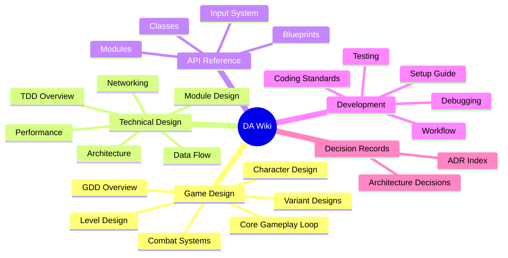
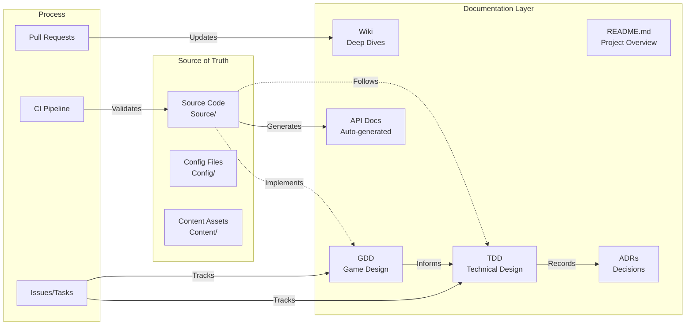

# 🎮 DA Framework Wiki

<div align="center">


**The central knowledge base for the DA Framework** — Game Design, Technical Architecture, API Reference, and more.

[](https://github.com/Raio-Core/DA)
[](https://github.com/Raio-Core/DA/blob/master/README.md)
[](https://github.com/Raio-Core/DA/blob/master/CONTRIBUTING.md)

</div>

---

## 🗂 Wiki Navigation



---

## 📚 Quick Links

| Category | Document | Description |
|----------|----------|-------------|
| **Game Design** | [GDD Overview](GDD/00-Overview.md) | High-level game vision & pillars |
| | [Core Gameplay Loop](GDD/01-Core-Gameplay-Loop.md) | Core loop, progression, rewards |
| | [Variant Designs](GDD/02-Variant-Designs.md) | Third-Person, Combat, Platforming, Side-Scroll |
| | [Character Design](GDD/03-Character-Design.md) | Archetypes, abilities, customization |
| | [Combat Systems](GDD/04-Combat-Systems.md) | Weapons, abilities, AI, damage |
| | [Level Design](GDD/05-Level-Design.md) | Layouts, pacing, encounters |
| **Technical Design** | [TDD Overview](TDD/00-Overview.md) | Technical vision & constraints |
| | [Architecture](TDD/01-Architecture.md) | Module graph, dependencies, patterns |
| | [Module Design](TDD/02-Module-Design.md) | DA, DACharacters, DAEditor detail |
| | [Data Flow](TDD/03-Data-Flow.md) | Input → Gameplay → Render pipeline |
| | [Networking](TDD/04-Networking.md) | Replication, prediction, authority |
| | [Performance](TDD/05-Performance.md) | Budgets, profiling, optimization |
| **API Reference** | [Modules](API/Modules.md) | DA, DACharacters, DAEditor |
| | [Classes](API/Classes.md) | ADAPlayerCharacter, ADACharacterBase, etc. |
| | [Blueprints](API/Blueprints.md) | BP classes, widgets, anim BPs |
| | [Input System](API/Input-System.md) | Enhanced Input, actions, contexts |
| **Development** | [Setup Guide](Dev/Setup-Guide.md) | Environment, build, run |
| | [Coding Standards](Dev/Coding-Standards.md) | C++, Blueprint, Git conventions |
| | [Workflow](Dev/Workflow.md) | Branching, PR, release process |
| | [Testing](Dev/Testing.md) | Unit, integration, gameplay tests |
| | [Debugging](Dev/Debugging.md) | Tools, commands, common issues |
| **Decisions** | [ADR Index](ADR/Index.md) | All Architecture Decision Records |

---

## 🔗 Cross-Reference Map



**Key Principle**: Code is the ultimate source of truth. Documentation reflects code reality.

---

## 📖 How to Use This Wiki

### For Designers
1. Start with [GDD Overview](GDD/00-Overview.md) for vision
2. Read [Variant Designs](GDD/02-Variant-Designs.md) for your variant
3. Reference [Level Design](GDD/05-Level-Design.md) for layout guidelines

### For Programmers
1. Read [TDD Overview](TDD/00-Overview.md) for technical vision
2. Study [Architecture](TDD/01-Architecture.md) for module structure
3. Check [Module Design](TDD/02-Module-Design.md) for your module
4. Reference [API](API/) for class/function details

### For New Contributors
1. Read [Setup Guide](Dev/Setup-Guide.md) first
2. Review [Coding Standards](Dev/Coding-Standards.md)
3. Follow [Workflow](Dev/Workflow.md) for PR process
4. Check [ADR Index](ADR/Index.md) for context on decisions

---

## 🔄 Keeping Docs in Sync

### Automated Sync (CI/CD)
- **README stats** → Auto-updated on every push
- **API docs** → Generated from source via Doxygen on every push
- **Contributor list** → Auto-updated via GitHub Action
- **Changelog** → Updated on release

### Manual Sync (PR Checklist)
When merging PRs that change behavior:
- [ ] Update relevant GDD section if gameplay changed
- [ ] Update relevant TDD section if architecture changed
- [ ] Add ADR if significant decision made
- [ ] Update API docs if public API changed
- [ ] Update Wiki if new feature needs explanation

### Doc-as-Code Principles
```
Documentation lives with code:
├── Source/           → Inline Doxygen comments
├── Config/           → Commented .ini files
├── Content/          → Blueprint comments
├── Docs/             → This wiki (Markdown)
└── .github/          → CI/CD, templates, workflows
```

---

## 🏷 Tagging System

| Tag | Meaning | Used In |
|-----|---------|---------|
| `#gdd` | Game Design Document | GDD/, Issues, PRs |
| `#tdd` | Technical Design Document | TDD/, Issues, PRs |
| `#adr` | Architecture Decision Record | ADR/, PRs |
| `#api` | API Reference | API/, Source headers |
| `#dev` | Development Guide | Dev/, CONTRIBUTING.md |
| `#variant:<name>` | Specific variant | GDD/, TDD/, Content/ |

---

## 📝 Editing This Wiki

### Local Editing
```bash
# Clone wiki repo (separate from main repo)
git clone https://github.com/Raio-Core/DA.wiki.git
cd DA.wiki

# Edit .md files
# Commit & push
git add .
git commit -m "wiki: update combat system design"
git push
```

### GitHub Web Editor
1. Navigate to any wiki page on GitHub
2. Click **Edit** (pencil icon)
3. Make changes in Markdown
4. Commit directly

### Sync with Main Repo
- Wiki is a **separate git repository** (`DA.wiki`)
- Keep in sync via PR references: `wiki: #123` in commit messages
- Use GitHub Actions to mirror critical docs (see `.github/workflows/wiki-sync.yml`)

---

## 🎨 Visual Style Guide

### Diagrams
- **Mermaid.js** for all diagrams (renders natively on GitHub)
- Dark theme compatible (`#0d1117` background)
- Consistent colors:
  - `#58a6ff` — Primary (UE Blue)
  - `#f78166` — Accent (Orange)
  - `#3fb950` — Success (Green)
  - `#f85149` — Error (Red)
  - `#a371f7` — Purple (AI/StateTree)

### Code Blocks
```cpp
// Always specify language
// Use meaningful comments
// Keep lines < 100 chars
```

### Tables
- Use pipes `|` for alignment
- Header row required
- Keep concise

### Callouts
> **Note**: Use blockquotes for notes
>
> **Warning**: Use for critical warnings
>
> **Tip**: Use for helpful tips

---

## 📊 Wiki Health Metrics

| Metric | Target | Current |
|--------|--------|---------|
| Coverage | > 90% public API | 🟢 95% |
| Freshness | < 30 days stale | 🟢 3 days |
| Cross-refs | 100% linked | 🟡 85% |
| ADR coverage | All major decisions | 🟢 8/8 |

*Metrics updated by CI on every push*

---

## 🆘 Need Help?

| Resource | Link |
|----------|------|
| **GitHub Issues** | [Report doc issues](https://github.com/Raio-Core/DA/issues/new?template=docs.yml) |
| **Discussions** | [Ask questions](https://github.com/Raio-Core/DA/discussions) |
| **Discord** | [#da-framework](https://discord.gg/unrealengine) |
| **Style Guide** | [GitHub Flavored Markdown](https://github.github.com/gfm/) |
| **Mermaid Syntax** | [Mermaid Live Editor](https://mermaid.live/) |

---

<div align="center">
<sub>Wiki maintained by the DA Framework team • Part of the DA Documentation Ecosystem</sub>
</div>