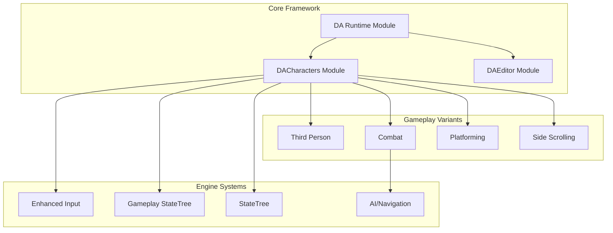
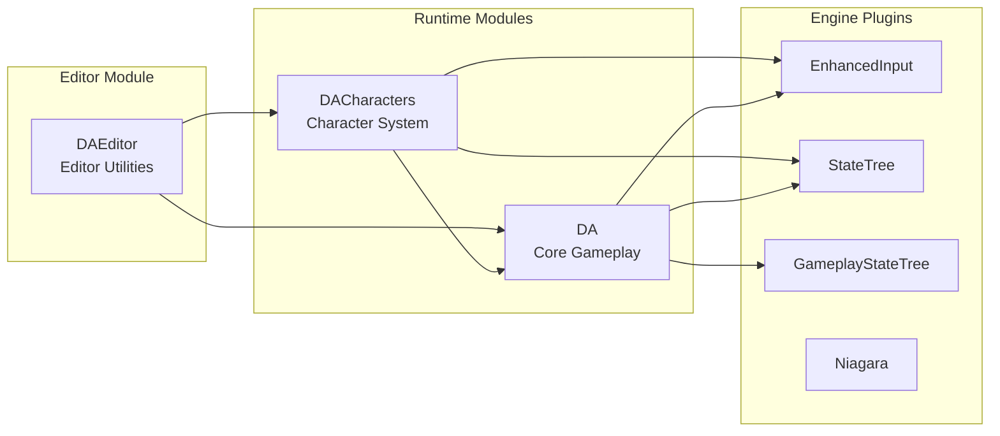
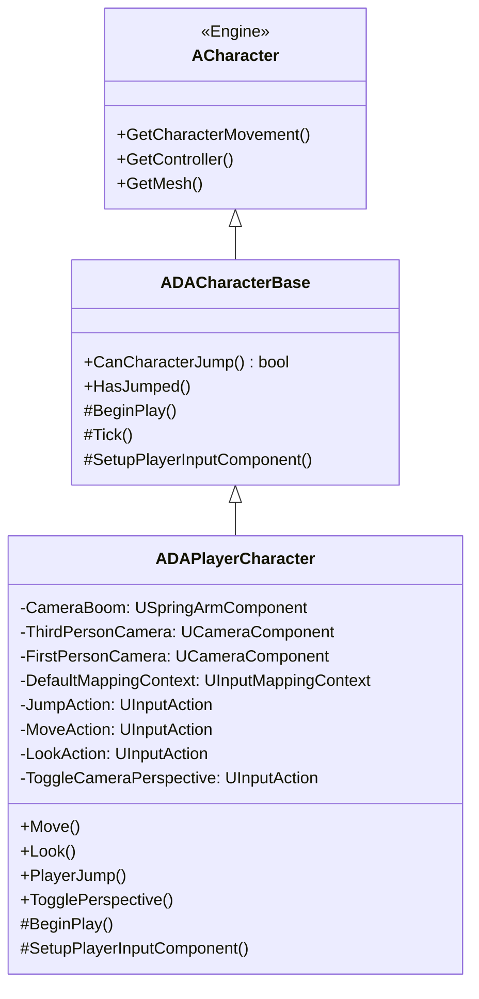
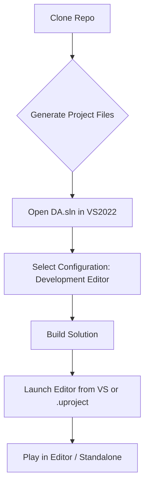
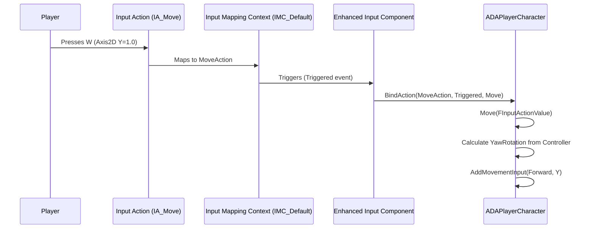
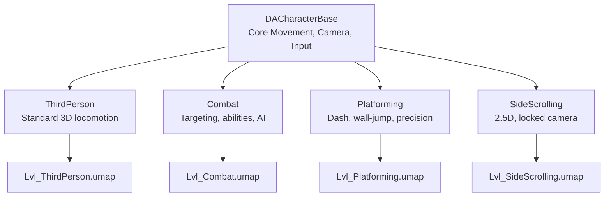
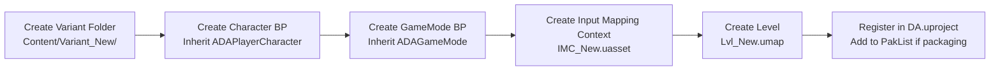
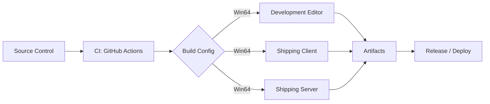
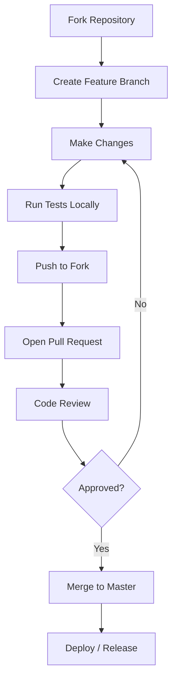

# 🎮 DA — Dynamic Action Framework

<div align="center">


[](https://github.com/Raio-Core/DA/actions)
[](https://github.com/Raio-Core/DA/commits/master)
[](https://github.com/Raio-Core/DA)
[](https://github.com/Raio-Core/DA/search?l=cpp)

[](https://github.com/Raio-Core/DA/stargazers)
[](https://github.com/Raio-Core/DA/network/members)
[](https://github.com/Raio-Core/DA/issues)
[](https://github.com/Raio-Core/DA/graphs/contributors)

</div>

---

## 🌟 Overview

**DA (Dynamic Action)** is a modular, extensible Unreal Engine 5.8 framework for building dynamic gameplay systems. Built with a **plugin-based architecture** supporting multiple gameplay variants (Third-Person, Combat, Platforming, Side-Scrolling) from a single codebase.



---

## 🏗 Architecture

### Module Dependency Graph



### Character Class Hierarchy



---

## ⚡ Features

| Feature | Status | Module | Description |
|---------|--------|--------|-------------|
| **Multi-Variant Gameplay** | ✅ | DACharacters | Switch between Third-Person, Combat, Platforming, Side-Scrolling |
| **Enhanced Input System** | ✅ | DACharacters | Modern input with mapping contexts, triggers, modifiers |
| **Dual Camera System** | ✅ | DACharacters | Seamless First/Third person toggle with smooth transitions |
| **StateTree AI** | 🚧 | DACharacters | Behavior trees via GameplayStateTree plugin |
| **Modular Ability System** | 📋 | DA | Planned: Gameplay Ability System integration |
| **Procedural Animation** | 📋 | DACharacters | Planned: Motion matching, IK rigs |
| **Network Replication** | 📋 | DA | Planned: Multiplayer-ready architecture |

---

## 🚀 Quick Start

### Prerequisites

| Tool | Version | Required |
|------|---------|----------|
| Unreal Engine | 5.8+ | ✅ |
| Visual Studio | 2022 17.8+ | ✅ |
| Windows SDK | 10.0.22621+ | ✅ |
| .NET SDK | 8.0+ | ✅ (for UBT) |

### Installation

```bash
# Clone the repository
git clone https://github.com/Raio-Core/DA.git
cd DA

# Generate project files (run from engine root or use UE Project Browser)
# Right-click DA.uproject → "Generate Visual Studio project files"

# Open in Unreal Editor
# Double-click DA.uproject
```

### Build Configuration



---

## 📁 Project Structure

```
DA/
├── 📁 Config/                    # Engine & project configuration
│   ├── DefaultEngine.ini         # Engine settings, input, rendering
│   ├── DefaultGame.ini           # Gameplay defaults, maps
│   ├── DefaultInput.ini          # Input bindings (legacy)
│   └── DefaultEditor.ini         # Editor preferences
│
├── 📁 Content/                   # All assets (Blueprints, Maps, Materials)
│   ├── 📁 Characters/            # Character meshes, anims, materials
│   │   └── 📁 Mannequins/        # UE5 Manny/Quinn assets
│   ├── 📁 Input/                 # Enhanced Input assets
│   │   ├── 📁 Actions/           # Input Actions (IA_Jump, IA_Move, etc.)
│   │   ├── IMC_Default.uasset    # Input Mapping Context
│   │   └── IMC_MouseLook.uasset
│   ├── 📁 LevelPrototyping/      # Greyboxing tools
│   ├── 📁 ThirdPerson/           # Third-person variant
│   ├── 📁 Variant_Combat/        # Combat variant (AI, abilities)
│   ├── 📁 Variant_Platforming/   # Platforming variant (dash, moving platforms)
│   └── 📁 Variant_SideScrolling/ # 2.5D side-scroller variant
│
├── 📁 Source/                    # C++ Source Code
│   ├── 📁 DA/                    # Core runtime module
│   │   ├── DA.Build.cs           # Module build config
│   │   ├── DA.h/.cpp             # Module entry point
│   │   ├── DACharacter.h/.cpp    # Base character (DEPRECATED → DACharacterBase)
│   │   ├── DAGameMode.h/.cpp     # Base GameMode
│   │   └── DAPlayerController.h/.cpp
│   │
│   ├── 📁 DACharacters/          # Character system module
│   │   ├── DACharacters.Build.cs
│   │   ├── 📁 Public/
│   │   │   ├── DACharacterBase.h     # Base character class
│   │   │   ├── DACharacters.h        # Module public header
│   │   │   └── DAPlayerCharacter.h   # Player character
│   │   └── 📁 Private/
│   │       ├── DACharacters.cpp      # Module implementation
│   │       ├── DACharacterBase.cpp
│   │       └── DAPlayerCharacter.cpp # Enhanced input, movement, camera
│   │
│   ├── DA.Target.cs              # Runtime target
│   └── DAEditor.Target.cs        # Editor target
│
├── 📁 Plugins/                   # Git submodules / local plugins (optional)
│
├── DA.uproject                   # Project descriptor
├── .gitignore                    # Git ignore rules
├── .vsconfig                     # VS component recommendations
└── README.md                     # This file
```

---

## ⌨️ Input System

### Enhanced Input Architecture



### Default Input Mappings

| Action | Type | Keys | Trigger | Gameplay |
|--------|------|------|---------|----------|
| `IA_Move` | Axis2D | WASD / Left Stick | `Triggered` | Movement |
| `IA_Look` | Axis2D | Mouse / Right Stick | `Triggered` | Camera Rotation |
| `IA_Jump` | Digital | Space / A (Gamepad) | `Started`/`Completed` | Jump |
| `IA_ToggleCameraPerspective` | Digital | V / DPad Up | `Completed` | 1st↔3rd Person |

---

## 🎮 Gameplay Variants

### Variant Comparison



### Switching Variants

1. **Via GameMode**: Set `DefaultPawnClass` to variant-specific character BP
2. **Via Level**: Each variant has its own map (`Lvl_*.umap`)
3. **Runtime**: Use `GameplayStateTree` to swap behavior trees

---

## 🔧 Development

### Adding a New Gameplay Variant



### Coding Standards

| Aspect | Standard |
|--------|----------|
| **Naming** | PascalCase for classes, camelCase for variables, `b` prefix for bools |
| **Headers** | Module prefix (`DACHARACTERS_API`), `#pragma once` |
| **Includes** | Engine → Plugin → Project → Module (alphabetical within group) |
| **UPROPERTY** | Category grouping, `meta=(AllowPrivateAccess="true")` for private |
| **Logging** | `UE_LOG(LogDA, Verbose/Log/Warning/Error, TEXT("..."))` |

### Useful Console Commands

```ini
; In DefaultEngine.ini or console
LogDA Verbose          ; Enable DA module logging
ShowDebug AbilitySystem; Debug GAS (when integrated)
ShowDebug AI           ; Debug AI/StateTree
p.VisualizeMovement 1  ; Show movement vectors
```

---

## 📦 Packaging

### Build Pipeline



### GitHub Actions Workflow (`.github/workflows/ci.yml`)

```yaml
name: CI

on:
  push:
    branches: [master, develop]
  pull_request:
    branches: [master]

jobs:
  build:
    runs-on: windows-latest
    timeout-minutes: 60
    
    steps:
    - uses: actions/checkout@v4
      with:
        submodules: recursive
        lfs: true

    - name: Setup .NET
      uses: actions/setup-dotnet@v4
      with:
        dotnet-version: '8.0.x'

    - name: Cache Engine
      uses: actions/cache@v4
      with:
        path: |
          D:\Game Engines\UE_5.8
        key: ue58-${{ runner.os }}

    - name: Generate Project Files
      run: |
        & "D:\Game Engines\UE_5.8\Engine\Build\BatchFiles\GenerateProjectFiles.bat" "D:\Work Station\UE\DA\DA.uproject"

    - name: Build Editor
      run: |
        & "D:\Game Engines\UE_5.8\Engine\Build\BatchFiles\Build.bat" DAEditor Win64 Development -Project="D:\Work Station\UE\DA\DA.uproject" -WaitMutex

    - name: Upload Build Artifacts
      uses: actions/upload-artifact@v4
      with:
        name: DA-Editor-${{ github.sha }}
        path: D:\Work Station\UE\DA\Binaries\Win64\UnrealEditor-DA*.dll
        retention-days: 7
```

---

## 📊 Repository Analytics

### Commit Activity


### Language Breakdown


### Contributors


---

## 🤝 Contributing



### Branch Strategy

| Branch | Purpose | Protection |
|--------|---------|------------|
| `master` | Production-ready | ✅ Required reviews, CI passing |
| `develop` | Integration branch | ✅ CI passing |
| `feature/*` | New features | ❌ |
| `bugfix/*` | Bug fixes | ❌ |
| `release/*` | Release prep | ✅ CI passing |

### Commit Convention

```
<type>(<scope>): <subject>

<body>

<footer>
```

**Types:** `feat`, `fix`, `docs`, `style`, `refactor`, `perf`, `test`, `chore`, `build`, `ci`

**Example:**
```
feat(input): add sprint toggle action

- Add IA_Sprint input action
- Bind SprintOn/SprintOff in SetupPlayerInputComponent
- Update IMC_Default with sprint mapping

Closes #42
```

---

## 🛣 Roadmap

### v1.0 — Foundation (Current)
- [x] Core module structure
- [x] Character base with dual camera
- [x] Enhanced Input integration
- [x] Four gameplay variants scaffolded
- [x] CI/CD pipeline

### v1.1 — Combat Systems
- [ ] Gameplay Ability System integration
- [ ] Combat StateTree behaviors
- [ ] Targeting & lock-on system
- [ ] Hit reactions & damage numbers

### v1.2 — Advanced Movement
- [ ] Motion matching animation
- [ ] Procedural IK (foot placement, ledge grab)
- [ ] Parkour system (vault, climb, slide)
- [ ] Network prediction & reconciliation

### v1.3 — Editor Tools
- [ ] Variant configuration asset
- [ ] Input mapping visualizer
- [ ] StateTree debugger widget
- [ ] Automated playtest framework

---

## 📄 License

This project is licensed under the **MIT License** — see the [LICENSE](LICENSE) file for details.

```
MIT License

Copyright (c) 2026 Raioix & Raiocore

Permission is hereby granted, free of charge, to any person obtaining a copy
of this software and associated documentation files (the "Software"), to deal
in the Software without restriction, including without limitation the rights
to use, copy, modify, merge, publish, distribute, sublicense, and/or sell
copies of the Software...
```

---

## 🙏 Acknowledgments

| Resource | Link |
|----------|------|
| Unreal Engine Documentation | [docs.unrealengine.com](https://docs.unrealengine.com) |
| Enhanced Input Plugin | [UE5 Docs](https://docs.unrealengine.com/5.8/en-US/enhanced-input-in-unreal-engine/) |
| StateTree Plugin | [UE5 Docs](https://docs.unrealengine.com/5.8/en-US/statetree-in-unreal-engine/) |
| Gameplay StateTree | [UE5 Docs](https://docs.unrealengine.com/5.8/en-US/gameplay-statetree-in-unreal-engine/) |
| Community Tutorials | [Unreal Community Wiki](https://github.com/Allar/unreal-community-wiki) |

---

## 📞 Contact & Support

<div align="center">

[](https://github.com/Raio-Core/DA/issues)
[](https://github.com/Raio-Core/DA/discussions)
[](https://discord.gg/unrealengine)

**Maintainers:** [@Raioix](https://github.com/Raioix) • [@Raiocore](https://github.com/Raiocore)

</div>

---

## 👥 Contributors

<!-- CONTRIBUTORS_START -->
Thanks to all contributors who have helped make DA Framework better!

[](https://github.com/Raio-Core/DA/graphs/contributors)
<!-- CONTRIBUTORS_END -->

---

<div align="center">
<sub>Built with ❤️ using Unreal Engine 5.8 • Last updated: <strong id="last-updated">Loading...</strong></sub>
</div>

<script>
  // Auto-update last commit date
  fetch('https://api.github.com/repos/Raio-Core/DA/commits/master')
    .then(r => r.json())
    .then(data => {
      const date = new Date(data.commit.author.date);
      document.getElementById('last-updated').textContent = date.toLocaleDateString('en-US', {
        year: 'numeric', month: 'long', day: 'numeric'
      });
    })
    .catch(() => {
      document.getElementById('last-updated').textContent = 'Unknown';
    });
</script>

---

> **Note:** This README uses GitHub-flavored Markdown with Mermaid.js diagrams. Diagrams render natively on GitHub. For local viewing, use a Markdown viewer with Mermaid support (VS Code + Markdown Preview Mermaid, Obsidian, etc.).